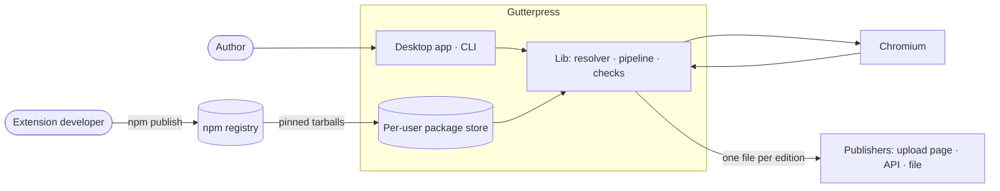
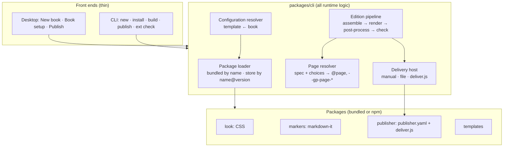
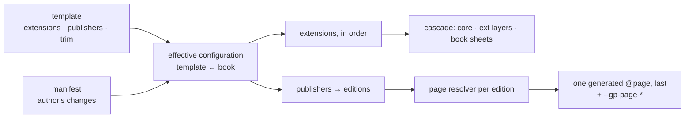

# Design: publishing and packages (0.12)

Status: proposed · 2026-10-30 · Supersedes ADR 0008 · Tracking: #453 (0.12) and #454 (0.11.23 groundwork)

## 1. Summary

An author picks a template, writes Markdown, and clicks Publish; each publisher reports "Ready" or what to fix and delivers its own file. A developer ships one npm package that may contribute a look, markers, snippets, settings, a publisher or templates. Core knows no publisher, look or template by name: it holds a package store, a configuration resolver, a per-edition render pipeline and one delivery interface. Nothing is copied into a book; packages are referenced by name and version and fetched into a per-user store.

The reference designs this follows: Vellum and Atticus for the author's model (style, trim, generate per store); Typst for packages and templates from a per-user cache; Quarto for pluggable publish providers with a non-secret record in the project; Jekyll gem themes for "a look is a dependency you override, not a copy"; Obsidian for a few-file plugin with its own settings tab and CSS variables as the contract.

## 2. Goals and non-goals

**Goals**

- Common paths need no YAML and no CSS: new book, write, publish, change a look setting, switch publisher.
- Store requirements live in publisher packages, never in the author's settings.
- Extension developers write files of kinds they know; composition uses npm, not a mechanism of ours.
- One owner per fact; every value in the UI says where it came from.
- Every existing book builds the same file after migration.

**Non-goals (0.12)**

Covers. Four-edge bleed with crop marks (representable, not built). Templates referencing templates. Editing scoped tokens in the app. Parallel renders. A `web` edition.

## 3. Who, and the scenarios that must work

| Who | Scenario | Result |
|---|---|---|
| Author | New book from "Dimm City adventure", write, Publish | DriveThruRPG print: Ready, open the upload page |
| Author | New book from a saved "University paper" template, write, Publish | PDF with the university's branding saved to Google Drive |
| Developer | Build a Pathfinder package: look, markers, a template that targets itch | `ext check` passes; `npm publish`; found by search in the app |
| Author | Blank book, search "pathfinder", add it, add Shopify, write, Publish | Two files, delivered to itch and to Shopify |
| Author | Dimm City content, publish to Amazon instead of DriveThruRPG | Turn one publisher off, one on; the app writes two manifest lines |

## 4. System context



## 5. Containers and responsibilities



Core owns the five boxes in the middle and nothing in the right-hand column. Adding or correcting a publisher, a look or a template is a package change.

## 6. Domain model

```mermaid
classDiagram
  class Package {
    name
    version
    npm dependencies
  }
  class Look {
    styles: CSS files
    page margin default via at-page
  }
  class Markers {
    markdown-it plugin
  }
  class Settings {
    tokens: group to stylesheet
  }
  class Publisher {
    spec: publisher.yaml
    adapter: deliver.js optional
  }
  class Template {
    name
    extensions[]
    publishers{}
    trim
  }
  class Book {
    manifest: author's choices
    chapters
    styles/book.css
  }
  class Edition {
    publisher
    kind: print or digital
    trim, margins
    file, findings, delivery
  }
  Package o-- Look
  Package o-- Markers
  Package o-- Settings
  Package o-- Publisher
  Package o-- Template
  Book --> Template : references name@version
  Book --> Package : extensions, pinned
  Book --> Edition : one per publisher edition
  Edition --> Publisher : rules and delivery
```

## 7. Contracts

### 7.1 Package (`package.json`)

```json
"gutterpress": {
  "styles": ["look.css"],
  "markdown": "plugin.js",
  "snippets": "snippets",
  "tokens": { "Palette": "tokens.css" },
  "publisher": "publisher.yaml",
  "templates": {
    "adventure": { "name": "Pathfinder adventure", "extensions": ["gp-pathfinder", "itch"], "publishers": { "itch": {} }, "page": { "trim": "letter" } }
  }
}
```

Every key optional. Names in a template are bundled packages or entries in `dependencies`. `tokens` is new; `publisher` and `templates` are new; the rest exist today.

### 7.2 Publisher (`publisher.yaml`)

```yaml
id: drivethrurpg
name: DriveThruRPG
editions:
  print:   { trims: [letter, digest, a4, 6x9], bleed: { top: 9, bottom: 9, outside: 9 }, safe: 18, gutter: 36,
             pdf: x1a, ink: 240, dpi: 300, pages: { multipleOf: 2 } }
  digital: { bleed: 0, pdf: pdf, links: keep }
deliver: manual            # manual · file · ./deliver.js
upload: https://…
settings: { product: { label: "Product page", type: url } }
```

Trim, bleed, safe area, gutter, PDF standard, ink limit, resolution, page-count rules, delivery: what every print shop states, as values. `deliver.js` exports `deliver({ file, edition, settings, secrets, log })`.

### 7.3 Book (`manifest.yaml`)

```yaml
title: The Gutter Job
template: gp-dimm-city/adventure@1.10.0
publishers:
  drivethrurpg: false
  amazon-kdp: { print: { trim: 6x9 } }
chapters: [01-intro.md, 02-the-job.md]
```

Only the author's choices. `extensions`, `page.margin`, `styles` and `checks` appear when the author changed them. Gone: `preset`, `targets`, `pdfx`, `publish`, `page.width`, `page.height`.

## 8. Resolution



One merge rule, `template ← book`, in the same order the CSS cascades. The page resolver takes the publisher's rules and the author's choices: trim from the allowed list, margins from the look's `@page { margin }` unless the author set them, bleed added by the resolver. It writes one unnamed `@page` rule per edition, last, and publishes `--gp-page-*` for stylesheets to read. `@page` rules are never placed inside cascade layers, so a look's named pages win by page name and the generated rule wins only over unnamed ones; nothing in author CSS is rewritten (#454).

## 9. Key flows

### 9.1 Publish

```mermaid
sequenceDiagram
  actor Author
  participant App
  participant Lib
  participant Store
  participant Chromium
  participant Adapter
  Author->>App: Publish
  App->>Lib: build(manifest)
  Lib->>Store: resolve template and packages (pinned; fetch if absent)
  loop each edition
    Lib->>Lib: page resolver → @page, --gp-page-*
    Lib->>Chromium: render
    Chromium-->>Lib: PDF
    Lib->>Lib: post-process per spec (standard, boxes, links) · checks
    Lib-->>App: Ready, or findings
    App->>Adapter: deliver(file, edition, settings, secrets)
  end
```

### 9.2 New book and add-to-book

```mermaid
sequenceDiagram
  actor Author
  participant App
  participant Lib
  Author->>App: New book → pick template
  App->>Lib: templates from bundled, store, local packages (and npm search)
  App->>Lib: write manifest: template name@version; one empty chapter
  Note over App,Lib: Adding a package with templates to a book without one offers it once
```

### 9.3 Developer


## 10. Decisions

| Decision | Why | Rejected |
|---|---|---|
| Publishers are packages; core holds schema, resolver, pipeline, adapter interface | adding a publisher is not a core release; no special cases | presets and targets in core (ADR 0008) |
| One edition per publisher output | a print file with bleed and a digital file without are two files | one PDF validated against several targets |
| Templates are declared by packages and referenced live | nothing to go stale; the author's manifest is only their choices | copying a template's manifest into the book |
| Per-user store, exact pins | one download per machine; clean book folders; no `.gitignore` edits | vendoring into the book |
| Margins from the look's CSS, measured from the trim; one generated `@page` last; `@page` never layered | standard cascade does the work; named pages survive | writing the manifest's `@page` last inside the layered world; stripping author CSS |
| Core is the default look; tokens from one list | one owner; a book with no look is readable | three disagreeing name lists; a bundled `clean-book` |
| Settings exposed by `tokens`, a group per stylesheet; one Settings view per package | declared, not inferred; nothing depends on comments | the comment grammar; discovery by regex |

## 11. Migration

Manifests are read for one release and rewritten on first save: `preset` → the publisher's print edition; `targets` → editions; `pdfx` → the spec; `page.width`/`height` (the sheet) → the trim with bleed subtracted; `page.margin` loses the bleed on the bleed edges so the print file does not move; `publish.<provider>` → `publishers.<id>.settings`. Vendored folders are no longer read; the store fetches the pins; the notice says the folder can be deleted. Bundled looks declare their templates; `assets/templates/` goes. gp-dimm-city changes nothing it does not want to.

## 12. Rollout and verification

- **0.11.23 (#454):** `@page` out of layers; `--gp-page-*`; the Design tab reads the build's CSS. Nothing new in the manifest.
- **0.12:** this document, one release. Gates: every existing book builds the same file after migration; the five scenarios in section 3 pass by hand; `ext check` and the render-parity gate run in CI, including fixtures for a named page under author margins, a book's own `@page` margin, two looks, and one book with a print and a digital edition whose pages align once the trim origin is subtracted.

## 13. Open questions

1. Where a generic print shop's typed spec is stored: inline in the manifest, or as a local package. Manifest proposed.
2. The trim table's first entries: Letter, A4, Digest, 6×9, 5.5×8.5, A5.

## 14. References

- Vellum, print editions: https://help.vellum.pub/print/ · Atticus print export: https://www.vappingo.com/word-blog/atticus-review-kdp/
- Typst packages and templates: https://github.com/typst/packages/
- Quarto publish providers and `_publish.yml`: https://quarto.org/docs/publishing/quarto-pub
- Jekyll gem-based themes: https://jekyllrb.com/docs/themes/
- Obsidian CSS variables: https://docs.obsidian.md/Reference/CSS+variables/About+styling · Style Settings: https://github.com/mgmeyers/obsidian-style-settings
- Chromium behaviour verified in this design's session: `@page` ranked by cascade layer before page name; `var()` in `@page { size }` and `margin` resolved from `:root`.
