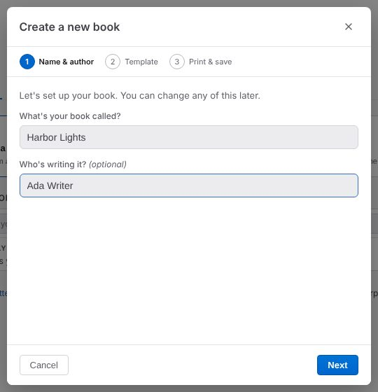
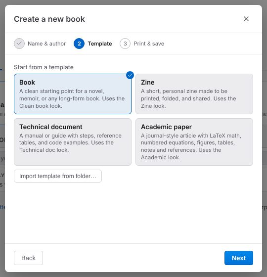
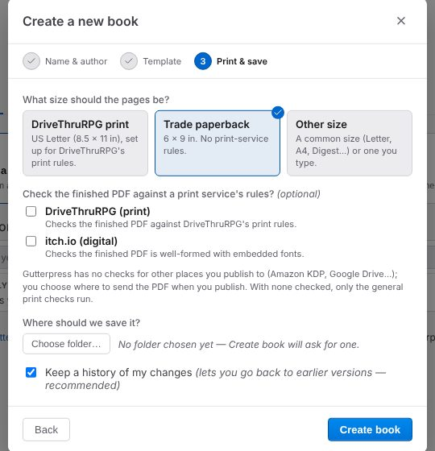

# Create a new book, or open one

Everything starts on the **Books** tab of the start screen. Click the folder button at the left
of the status bar ("Books — open the start screen") to get back to it from a book.

## Create a new book

1. On the Books tab, choose **Create a new book**.
2. **Name & author:** type the book's name under "What's your book called?" and, if you like,
   your name.
3. **Template:** pick a starting point — **Book** (a novel, memoir or any long-form book),
   **Zine**, **Technical document**, or **Academic paper** (a journal-style article with LaTeX
   math) — or one of your own saved templates. Each template comes with its look (Clean book,
   Zine, Technical doc or Academic), so the new book is styled from the first page.
4. **Print & save:**
   - Under **What size should the pages be?** choose **DriveThruRPG print** (US Letter),
     **Trade paperback** (6 × 9 in), or **Another size** and then a size (US Letter, Trade
     paperback, Digest, A4, A5, or your own width and height). The Zine and Technical document
     templates start on their own size (Digest and US Letter).
   - Under **Check the finished PDF against a print service's rules?** tick DriveThruRPG and/or
     itch.io if you publish there. Gutterpress has no checks for other places you publish to; you
     choose where to send the PDF when you publish.
   - Under **Where should we save it?** click **Choose folder…** (or leave it: **Create book**
     asks for a folder if none is chosen).
   - Leave **Keep version history** ticked. It keeps earlier versions of your book on your
     computer, with no account needed (see
     [Keep versions and back up your work](09-versions-and-backup.md)).
5. Click **Create book**.

  

## Open a book on this computer

On the Books tab, choose **Open a folder** and pick the book's folder. You can also paste a
folder path into the search box above **Your books** and click **Open**.

If the folder isn't set up as a book yet, Gutterpress offers **Set up as a book**, which lets you
edit its design and keep version history. **Not now** opens it as it is.

## Open a book from GitHub

1. On the Books tab, choose **Open from GitHub**.
2. Click **Connect GitHub**, then enter the code Gutterpress shows on the GitHub page that opens.
3. Choose the online copy. If it holds more than one book, choose the book.
4. Pick the revision to open, a name, and where to save it on your computer, then open it.

## Find your books again

The **Your books** list on the Books tab has **Currently open**, **Favorites**, **Recently
opened** and **Discovered** sections, and a search box. Click a book's star to add it to
Favorites; the X on a recent book takes it off the list (the book itself is not touched). A book
whose folder has moved shows **Not found**.

The book switcher next to the folder button in the status bar switches between books.

Next: [write and preview your book](03-write-and-preview.md).
