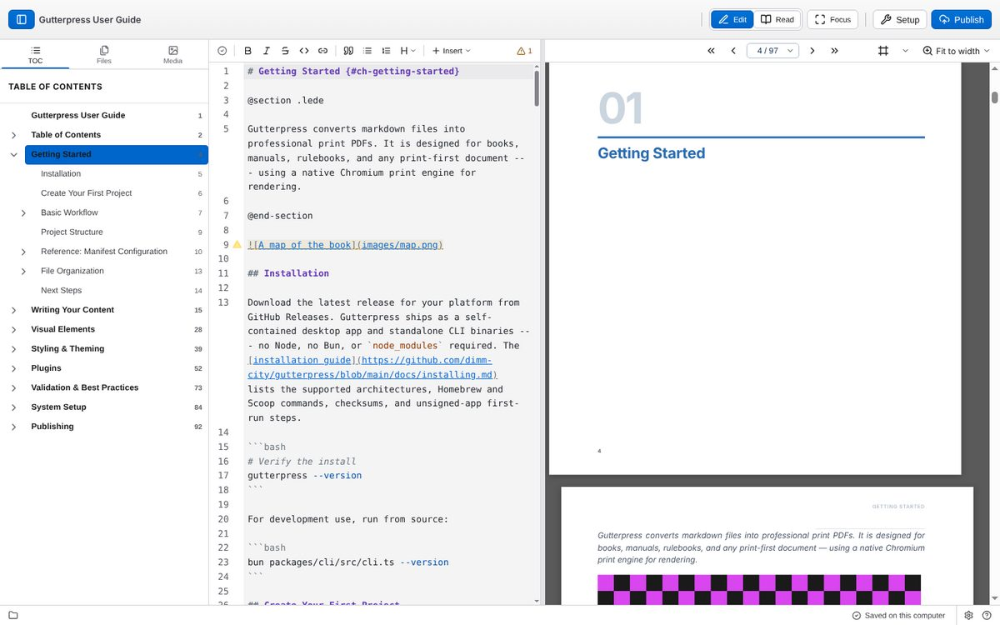
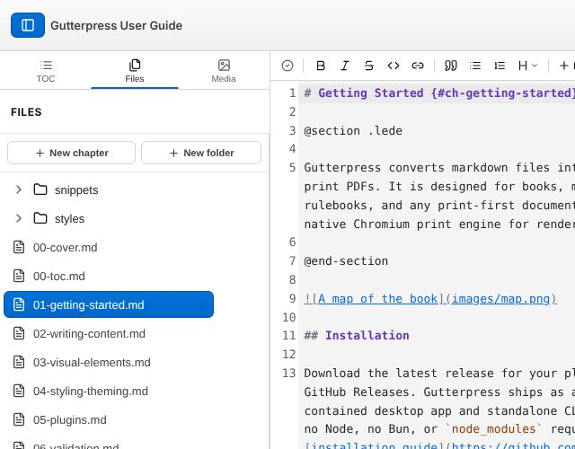
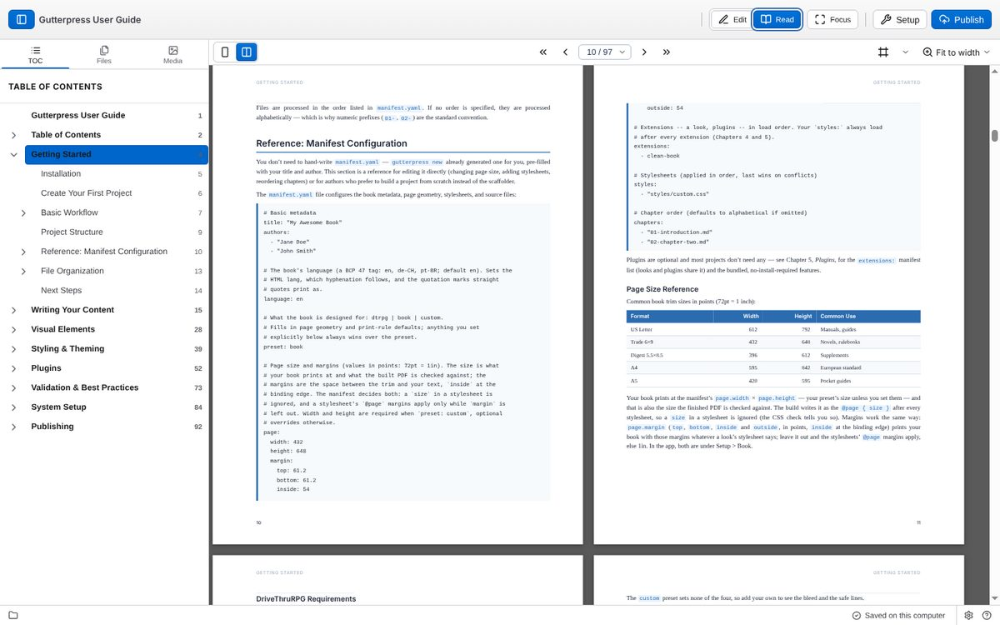
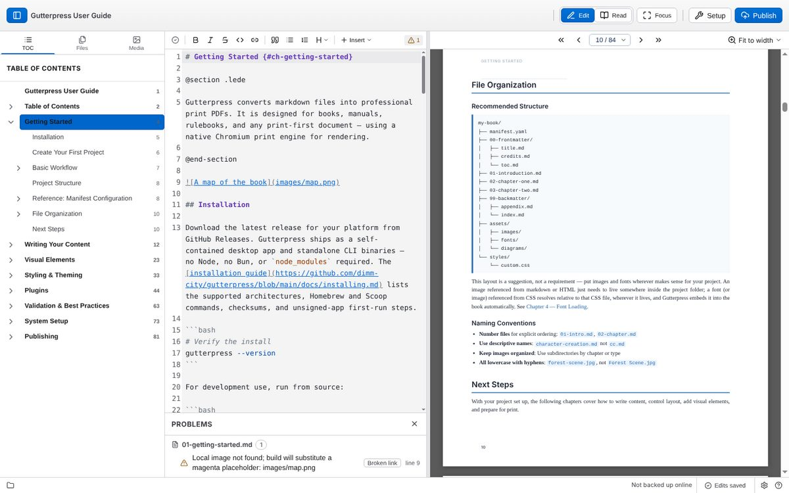

# Write and preview your book

## The toolbar

Across the top of the window, from the left:

- the **panel toggle** (Ctrl+\) shows or hides the left panel;
- **Edit** (Ctrl+E) puts the editor and the preview side by side;
- **Read** shows the preview on its own, two pages at a time;
- **Focus** hides the panels and toolbars; press Esc to bring them back;
- **Setup** (the wrench) opens [Book settings](05-design.md);
- **Publish** opens the [Publish](08-publish.md) view.

In a narrow window, Edit and Read become **Markdown** and **Preview** tabs.

## Write

The editor is on the left in Edit mode. Your writing is markdown; the
[writing chapter](https://gutterpress.dimm.city/docs/writing-content/) covers the syntax and the
layout markers.

The editor toolbar has buttons for bold, italic, strikethrough, inline code, links, quotes,
bulleted and numbered lists, and a heading picker. Its **Insert** menu adds a layout block
(**Chapter**, **Section**, **Two columns**, **Page break**, **Spread**), a horizontal rule, a
table, an image or a [snippet](04-snippets.md).

**Save** (Ctrl+S) saves now; it turns blue when there are unsaved changes. Edits are also saved
automatically unless you turn that off in Settings → Saving. The indicator in the status bar
reads **Edits saved**, **Saving…** or **Unsaved changes**.

### Pick a class from a list

Classes are how you tune a block or an image: `.gp-no-break`, `.gp-right`, a plugin's
`.dc-snug`. You do not have to remember them. In the editor, type a `.`

- after a marker word, as in `@section .`, or
- inside curly braces on any element, as in `## Title {.` or `{.`

and a list appears. It starts with Gutterpress's own `gp-*` classes, then the classes each
plugin your book uses documents in its component catalog, then the classes your book's own
stylesheets use. Each suggestion has a one-line description where there is one, and says where
it comes from. On an image the image classes come first; on a marker line a plugin's
classes for that marker do.

Keep typing to narrow the list, then press **Tab** or **Enter** to accept (**Esc** dismisses it).
**Ctrl+Space** asks for the list inside empty braces. The list works the same way as the `@`
suggestions for [markers and components](04-snippets.md#insert-a-component-with-).

### Change a block's properties

A marker block (`@section`, `@skill`, `@gear`, a plugin's own markers, `@page`) can be tuned from a
dialog, without typing a class or a marker by hand. Open it either way:

- **in the preview**, right-click the block's own edge or padding (not a paragraph inside it) and
  choose **Block properties…**; inside a page the menu also has **Page properties…** for the
  page itself;
- **in the editor**, put the cursor on the marker line and press **Alt+Enter** (Option+Enter on
  a Mac).

The dialog has:

- **Keep together** keeps the block whole: it moves to the next page rather than splitting
  (adds `.gp-no-break` to the marker line).
- **A section for each plugin** your book uses, with the modifiers its component catalog
  documents. For Dimm City these are **Avoid split** (`.dc-avoid-split`) and **Snug**
  (`.dc-snug`). A plugin that documents a modifier gets a toggle here with no change to
  Gutterpress.
- **Break before** puts a `@page-break` line directly above the block, so it starts on a new
  page. Turning it off removes that line (and any other page breaks stacked directly above).
- **Columns** wraps the block's content in `@columns N` … `@end-columns` (1 to 5), changes N,
  or unwraps it. It needs the block's own closing line (`@end-section`, `@end-skill`); without
  one the dialog says so and leaves it unavailable. A block that already has its own
  `@columns` run in the middle of its content is left for you to edit in the source.

Only what you change is edited. The variant word, `#id`, `label="…"`, other classes and
whichever spelling you use (`.class` or `{.class}`) stay exactly as written, and Apply with
nothing changed writes nothing. Edits made from the editor go into its undo history
(Ctrl+Z).

## Your book's files and images

The left panel has three tabs:

- **TOC** — the table of contents; click a heading to go to it.
- **Files** — your book's chapters. **New chapter** and **New folder** are at the top; hover a
  file for **Rename** and **Delete**. Deleting asks you to confirm, and the "Deleted" message
  that follows has an **Undo** button for the most recent delete.
- **Media** — your book's images. **Add images…** adds images to the book; select one and
  choose **Insert into document** to put it at the cursor.

## Preview

The preview shows your book's pages exactly as they will print, and updates as you type.

- **Turn pages** with the buttons above the preview (first, previous, the page picker, next,
  last), with a flick of the mouse wheel over the preview, or with the keys below.
- **Zoom** with the menu at the top right of the preview: **Fit to width** or 25%–200%. The
  starting zoom is set in Settings → App → Preview.
- **Check margins and bleed** with the **Margins and bleed** button beside the zoom menu. Each page
  gets a tinted margin area inside a dashed outline of the text block, and a red band for the
  bleed with a solid red line at the trim. Anything that spills past the margins is outlined: amber
  for the margin, red for across the trim. Art you placed on purpose (full-bleed images, pinned
  art) is outlined softly and not counted. The number on the button is how many elements spill
  over; hover for the details. It works in Read and Edit, the app remembers your choice, and it is
  for your eyes only: it is never printed, never in an exported PDF, and it does not move
  anything.
  - **Left-hand and right-hand pages.** If your book mirrors its margins (`@page :left` and
    `@page :right` with different left and right margins), every page shows its own margin box.
    Left-hand pages sit where the PDF puts them: the preview slides each left-hand page sideways
    by the difference between its margins and a right-hand page's, so the text, the running heads
    and the folio land where they will in print. Page breaks do not change.
  - **Where the bleed comes from.** A bleed set in your stylesheet (`@page { bleed }`) is drawn
    as a band around the page. Without one, a DriveThruRPG (`dtrpg`) book uses its preset's bleed:
    that file size already contains 0.125in of bleed on the top, bottom and outer edges (none on
    the binding edge), so the band and a solid trim line appear inside the page on those edges.
    With neither, you see the margins and no band, and the button's tooltip says "No bleed set";
    add `bleed: 0.125in;` to your `@page` rule to see it.
  - **Make it louder or quieter, or change its colour** in Settings → App → Preview: *Margin
    overlay strength* (Subtle, Normal or Strong: line width, margin tint and bleed band) and
    *Margin overlay colour* (the margin outline and tint). The lines stay the same thickness on
    screen at every zoom. These are app settings, not book CSS.

| Key | Does |
| --- | --- |
| Right arrow or Page Down | Next page |
| Left arrow or Page Up | Previous page |
| Home / End | First / last page |
| + or = / - | Zoom in / out |
| F | Fit to width |
| Ctrl+F | Find in the preview |

The page keys work when you are not typing in the editor or a field.

## Fix problems

The **Problems** badge in the editor toolbar checks your book as you work and reads
**No problems** or a summary. Click it to open the list at the bottom of the editor: problems are
grouped by file, and clicking one opens the file at the line it is about. Esc closes the list.

Next: [insert snippets and components](04-snippets.md).
