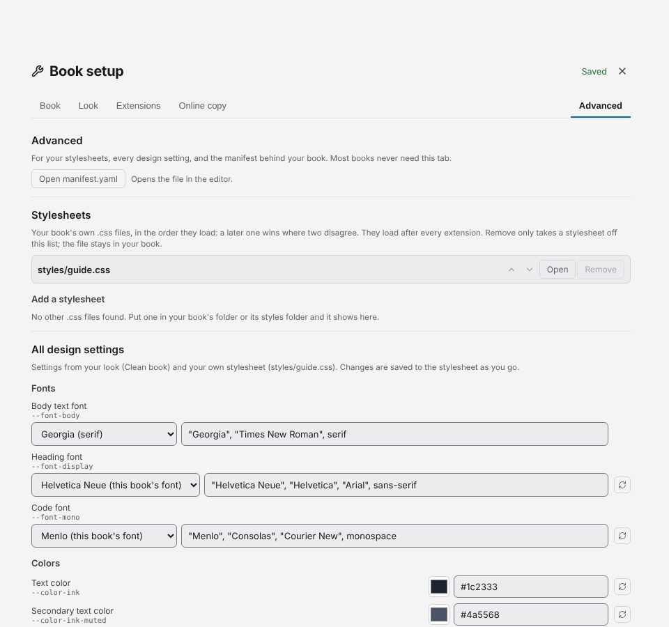

# Change your book's design

Click **Setup** (the wrench) in the toolbar to open **Book setup**. Its tabs are **Book**, **Look**,
**Extensions** and **Backup**, with **Advanced** set apart on the right. Close it with the X or Esc.
Every change is saved as you make it: there is no Save button, and the top of Book setup says
**Saving…** and then **Saved**.

## Title, page and chapters

On the **Book** tab:

- set the **Title** and **Authors** (**+ Add another author** adds another). A name is saved when
  you leave the field or press Enter;
- under **Page size**, choose the size the book prints at and is checked against: **DriveThruRPG
  print** (8.5 × 11 in plus bleed, set up for DriveThruRPG), **Trade paperback** (6 × 9 in), or
  **Another size** and then a size (US Letter, Trade paperback, Digest, A4, A5, or your own width
  and height in inches). These are the same choices as when you
  [create the book](02-books.md#create-a-new-book). The tab opens on the book's current size;
- under **Margins (inches)**, type the four margins (see below);
- under **Check the PDF against**, tick the print services whose rules the finished PDF should be
  checked against. The general print checks always run;
- under **Chapters**, the book's chapters are listed in reading order, each by its first heading
  with its file name beside it. Drag a chapter, or use its arrows, to move it. Untick one to leave
  it out of the book: it moves under **Not in the book**, and ticking it there adds it back at the
  end.

**Save as template…**, at the bottom, saves this book's look, page and extras as a template you
can start new books from.

## Choose a look

A *look* is a complete design for a book. On the **Look** tab, under **Choose a look**, each look
is a small picture of a page: **Clean book**, **Zine**, **Technical doc** and **Academic**, and any
look your book has from elsewhere. The one your book uses comes first, with a tick. Click another
to use it instead; Gutterpress saves the choice as soon as you stop, and the line under the
pictures says what the look is like. A new book already has the look its template came with.

A book that combines two looks (set up on the **Extensions** tab) says so above the pictures, and
its looks are changed there. Formatting extras such as callouts and math are on the Extensions tab
too: see [add plugins and formatting extras](06-plugins.md).

## Adjust the look

Under **Adjust the look** are the six settings every built-in look has: **Body text font**,
**Heading font**, **Body text size**, **Line spacing**, **Text color** and **Accent color** (headings
and links). The **Sample page** beside them shows each change as you make it. Your changes are
saved to your book's own stylesheet (`styles/book.css` unless you chose another; Gutterpress makes
one the first time you change something), never to the look itself, so they stay if you change
looks. A color or a number is saved when you leave its field or press Enter; type a color with or
without its `#` (anything that is not a color is not saved, and the field says so).
**Reset to the look's settings** asks first, then (**Replace**) takes your changes to these six out
again; **Undo changes** in Advanced brings them back.

## Every setting, and your stylesheets

**All settings in Advanced** opens the **Advanced** tab at **All design settings**: every setting
your look has, grouped into **Fonts**, **Colors**, **Sizes & numbers** and **Other**, each with the
CSS name you would use in a stylesheet. The undo arrow beside a value you changed earlier offers
**Use the look's value**; **Undo changes** undoes the changes made since you opened Book setup.

At the top of Advanced, **Open manifest.yaml** opens the book's manifest in the editor. Under
**Stylesheets** are the book's own `.css` files, in the order they load: a later one wins where two
disagree, and all of them load after your extensions. Each row has **↑** and **↓** to move it,
**Open**, which opens the file in the editor, and **Remove**, which takes it off the list and never
deletes the file. A book always keeps at least one stylesheet, so the last one has no Remove. Under
**Add a stylesheet** are the other `.css` files in your book's folder and its `styles` folder:
**Add** puts one at the end of the list. A book with no stylesheet says so and offers **Create
styles/book.css**. The [styling chapter](https://gutterpress.dimm.city/docs/styling-theming/) covers
what a stylesheet can do.

## Change the page size and margins

The page size and the margins are on the **Book** tab (see above), and you can change them at any
time. Both live in your book's manifest and nowhere else: the size you choose is the size your
book prints at and the size your finished PDF is checked against, and no stylesheet is edited.

Under **Page size**, choosing **DriveThruRPG print** or **Trade paperback** uses that preset's page
size and print checks; **Another size** takes a common size (Letter, A4, Digest…) or a width and
height you type. A book whose manifest gives it a size of its own shows **Another size** with that
size; choosing **DriveThruRPG print** or **Trade paperback** goes back to that preset's size. A book
that has never chosen its print checks follows the preset (DriveThruRPG print checks against
DriveThruRPG); once you tick or untick a service, the choice is yours.

Under **Margins (inches)**, type the top, bottom, inside and outside margins (inside is the edge at
the binding). A change is saved as soon as you leave the field, and your margins win over any a
look sets. A book that has not set its own margins yet shows the ones its look gives it, or the
1 in default, and says so; change one and they become yours. To go back, press **Use the look's
margins** (or **Use the default margins** when no look sets any): your margins are taken out of the
manifest and the fields show what the book prints with again. The built-in looks set neither a page
size nor margins, so what you choose here is what you get.

Next: [add plugins and formatting extras](06-plugins.md).
