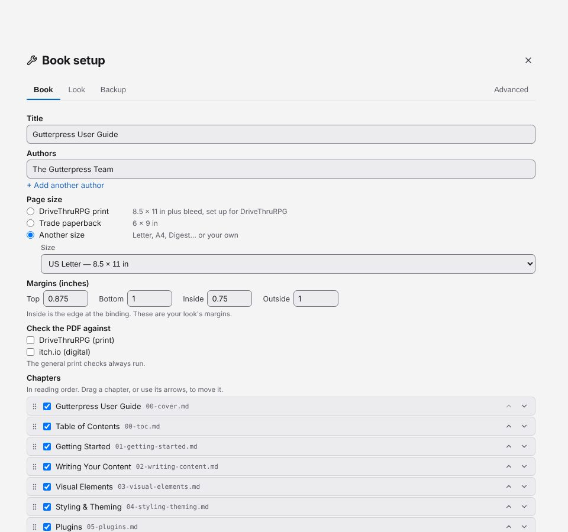
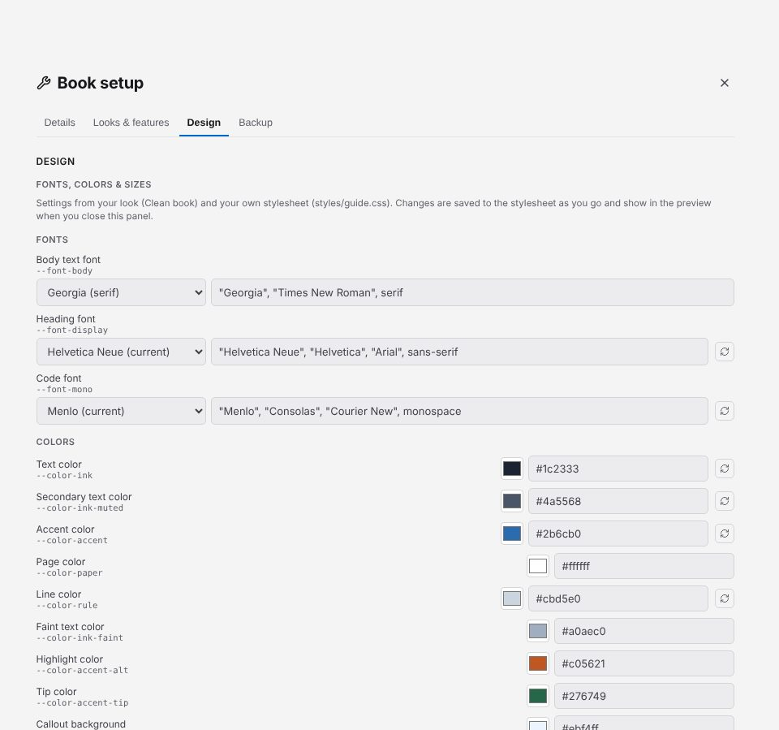

# Change your book's design

Click **Setup** (the wrench) in the toolbar to open **Book setup**. Its tabs are **Details**,
**Looks & features**, **Design** and **Backup**. Close it with the X or Esc. Every tab saves as you
go: there is no Save button, and **Changes saved** appears beside the heading when a change has
been written.

## Title, authors and chapters

On the **Details** tab:

- set the **Title** and **Authors** (**Add author** adds another). A name is saved when you leave
  the field or press Enter;
- under **Chapters**, tick the markdown files that belong in the book and drag them, or use **Move
  up** and **Move down**, to set the reading order;
- under **Page size**, choose the size the book prints at and is checked against: **DriveThruRPG
  print** (US Letter, set up for DriveThruRPG's print rules), **Trade paperback** (6 × 9 in), or
  **Other size** and then a size (US Letter, Trade paperback, Digest, A4, A5, or your own width and
  height in inches). These are the same choices as when you
  [create the book](02-books.md#create-a-new-book). The tab opens on the book's current size;
- under **Check the PDF against**, tick the print services whose rules the finished PDF should be
  checked against. Other places you publish to need no check here.

**Save as template…** saves this book's setup as a template you can start new books from.

## Choose a look

A *look* is a complete design for a book. Looks are listed with your features on the
**Looks & features** tab. Under **Add**, on the **Built in** tab, looks come first, each with a
small preview of what it does to a page: click **Add** next to **Clean book**, **Technical doc**,
**Zine** or **Academic**. Each look you have added is a row in the list, with the same preview,
where it can be turned off, moved up or down, or removed. Looks lower in the list win where they
disagree; when you add a second look, Gutterpress says so and names the one to turn off to use the
new look on its own. A new book already has the look its template came with.

To use a look from elsewhere, open **Advanced** under **Add** and choose **Import a .zip or
.css...** or **Add a folder or plugin file...**, or paste a URL into the URL field and click
**Import**. [Find plugins](https://gutterpress.dimm.city/plugins/) lists looks and other extensions
on npm.

## Fine-tune fonts, colors, sizes and margins

The **Design** tab names the look it is editing and shows its settings under **Fonts, colors &
sizes**, grouped into **Fonts**, **Colors**, **Sizes & numbers** and **Other**. The page margins
are there too (**Top & bottom margins** and **Side margins**) for every built-in look. Change a
value and Gutterpress saves it to your book's own stylesheet (`styles/book.css` unless you chose
another), never to the look itself; the preview shows the change when you close Book setup.
**Revert** undoes this session's changes; the undo arrow beside a value you changed earlier offers
**Use the look's value** instead. **Edit the stylesheet** opens the stylesheet itself. A book with
no look yet offers **Choose a look**, which opens Looks & features.

## Edit stylesheets

Under **Stylesheets** on the **Design** tab, each of the book's stylesheets can be turned on or
off, and **Edit** opens it in the editor. The [styling chapter](https://gutterpress.dimm.city/docs/styling-theming/)
covers what a stylesheet can do.

## Change the page size

Page size is on the **Details** tab (see above), and you can change it at any time. Choosing a
size updates two things together: the size your book prints at (the `@page` rule in your
stylesheet, edited in place, with the rest of the file left exactly as it was) and the size your
finished PDF is checked against. If your stylesheet has no page size yet, a small page rule is
added to the end of your book's own stylesheet. If a stylesheet and the book disagree, Details
says so and **Use this size in the stylesheet too** makes them match. The built-in looks never
set a page size of their own, so the size you choose here is the size you get.

Choosing **DriveThruRPG print** or **Trade paperback** uses that preset's page size and print
checks. A book that has never chosen its print checks follows the preset (DriveThruRPG print
checks against DriveThruRPG); once you tick or untick a service, the choice is yours.

Next: [add plugins and formatting extras](06-plugins.md).
