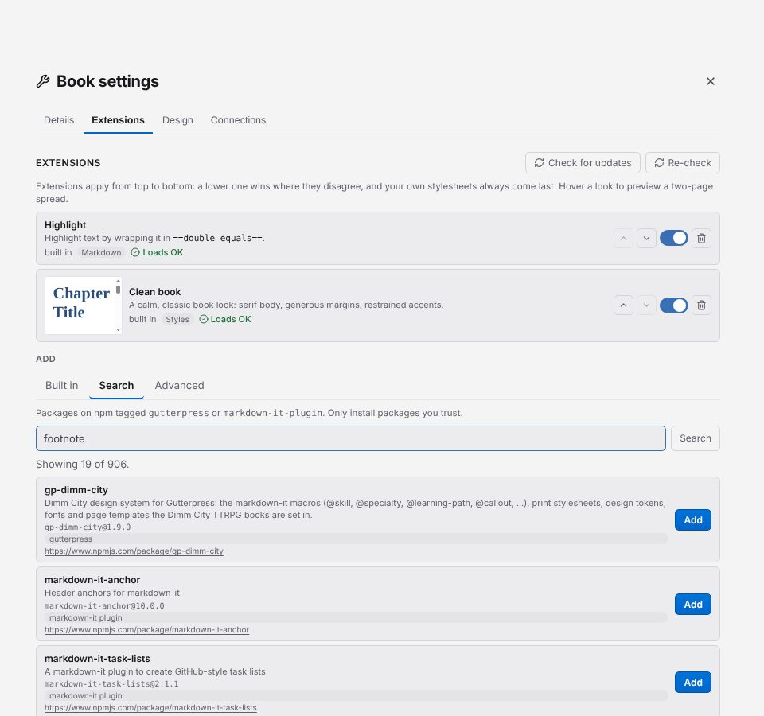
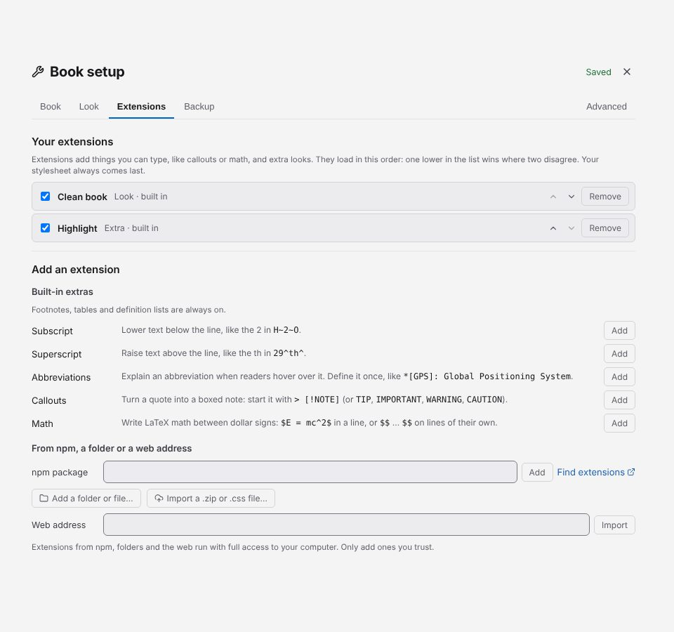

# Add plugins and formatting extras

Plugins add new markdown to your book: highlights, callouts, footnote styles, a game's components
and more. Six of them are built in; the rest come from npm or a folder. All of them are on the
**Extensions** tab of **Setup**.

## Turn on a formatting extra

Six extras are built in, with nothing to download. Open **Setup → Extensions**. Under **Add an
extension → Built-in extras**, each extra the book does not use yet has an **Add** button and says
what to type; click it and the extra works straight away, and appears in **Your extensions** above.
To take one out again, click its **Remove** there, and it is offered under **Built-in extras**
again (footnotes, tables and definition lists are always on):

| Extra | Type |
| --- | --- |
| Highlight | `==text==` |
| Subscript | `H~2~O` |
| Superscript | `29^th^` |
| Abbreviations | `*[GPS]: Global Positioning System` |
| Callouts | `> [!NOTE]`, `> [!TIP]`, `> [!IMPORTANT]`, `> [!WARNING]`, `> [!CAUTION]` |
| Math | `$E = mc^2$` in a line, or `$$` ... `$$` on lines of their own |

## Find a plugin on npm

Looks and plugins other authors have published are on npm. On **Setup → Extensions**, under **Add an
extension → Find one on npm**, type a word (such as `footnote` or `emoji`) and press Enter or click
**Search**; with nothing typed, **Search** lists the most relevant ones. Each result shows the
package's name, what it does, and whether it is a **Look** or an **Extra** when that is known.
**Add** downloads it, checks it, keeps a copy inside your book, and adds it to **Your extensions**;
your book then builds from that copy, even offline. A package your book already uses says **Added**.
If nothing matches, it says **No extensions found for** what you typed; if npm cannot be reached, it
says so under the box and you can search again.

## Add a plugin from elsewhere

Under **Add an extension → Other ways to add**:

- type a package's **Exact name** (with a version if you want one, such as
  `markdown-it-highlightjs@4.3.0`) and click **Add**, for a package that search does not find, such
  as a private one;
- **Add a folder or file…** adds a plugin you have on your computer, used where it is;
- **Import a .zip or .css file…**, or a **Web address** and **Import**, copies a look or plugin into
  your book's `extensions` folder.

Plugins from npm, folders and the web run with full access to your computer: only add ones you
trust.

## Keep plugins working and up to date

**Your extensions**, at the top of the Extensions tab, is everything your book uses, looks and
extras included, in the order they load: one lower in the list wins where two disagree, and your own
stylesheet always comes last. Each row says what it is and where it comes from, and has:

- a checkbox to use it or not, **↑** and **↓** to move it, and **Remove** (which deletes an npm
  plugin's downloaded copy);
- for a plugin from npm, a **Version** menu: its published versions, newest first, with the one
  your book uses marked **(current)**. Pick a version to switch to it, newer or older. Gutterpress
  downloads and checks it first, and your book keeps the version it had until that works; if it
  fails, it says so and nothing changes. The menu fills when the tab opens; if npm cannot be
  reached it says **Couldn't load the version list.**, and clicking the menu tries again;
- **x.y.z available** and **Update**, when npm has a newer version;
- **Couldn't load.** with **Show details**, when it fails, and **Install** or **Reinstall** for an
  npm plugin whose copy is missing or broken (or **Check again** for anything else). A plugin
  that works says nothing.

When your book has a plugin from npm, Gutterpress asks npm for newer versions each time you open the
Extensions tab, and **Check for updates**, at the top of the list, asks again (it reads **Checking
npm…** meanwhile). Under the list it says **Every installed package is at its latest version.**,
or why npm could not be asked. **Include pre-release versions**, above the list, adds alpha, beta
and release-candidate versions to the Version menus and counts them as updates. It is off by
default and applies to every book.

Every download from npm, an update or another version, first asks you to confirm that you trust
the package. The command line's `gutterpress ext` does the same things. The
[plugins chapter](https://gutterpress.dimm.city/docs/plugins/) covers ordering plugins and writing
your own.

Next: [save a PDF](07-export-pdf.md).
