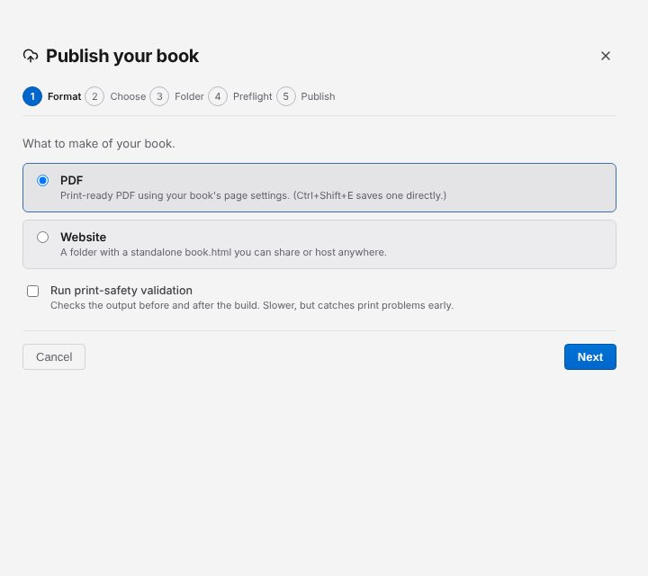

# Save a PDF

PDFs are made from the **Publish** view, where a folder on your computer is always one of the
destinations.

1. Click **Publish** in the toolbar.
2. Under **Format**, choose **PDF** ("Print-ready PDF using your book's page settings"). Tick
   **Check my book before saving** to check it for printing problems; unticked, no checks run
   and the PDF is saved sooner.
3. On **Choose**, the PDF goes to the `dist` folder inside your book unless you pick another
   folder with **Change…**.
4. If you ticked the checks, **Check** looks over the book first (see
   [Publish your book](08-publish.md#check)).
5. Click **Save**. While it runs, the step shows **Opening your book…** and then **Laying out
   and writing the PDF…**, with **Cancel**. When it finishes, **Show in folder** opens the folder with your PDF.
   With checks ticked, the book's PDF checks (page size, safe margins, embedded fonts, and PDF/X
   when qpdf and Ghostscript are installed) run on the saved file. The step says how many
   problems they found, and **Review problems** opens the list.

If the save fails, the step says why and keeps saying it until you try again; **Show details**
has the rest when there is more. The whole error is also in the app's log: on the start screen,
**Troubleshooting → Logs**.

**Shortcut:** Ctrl+Shift+E (Cmd+Shift+E on a Mac) saves a PDF straight away: choose where in the
save dialog, and "PDF saved to …" tells you when it's done, with **Show in Folder**.

The PDF uses your book's page size and design exactly as the preview shows it. To make a website
of your book instead, choose **Website** under Format.

Next: [publish your book](08-publish.md).
