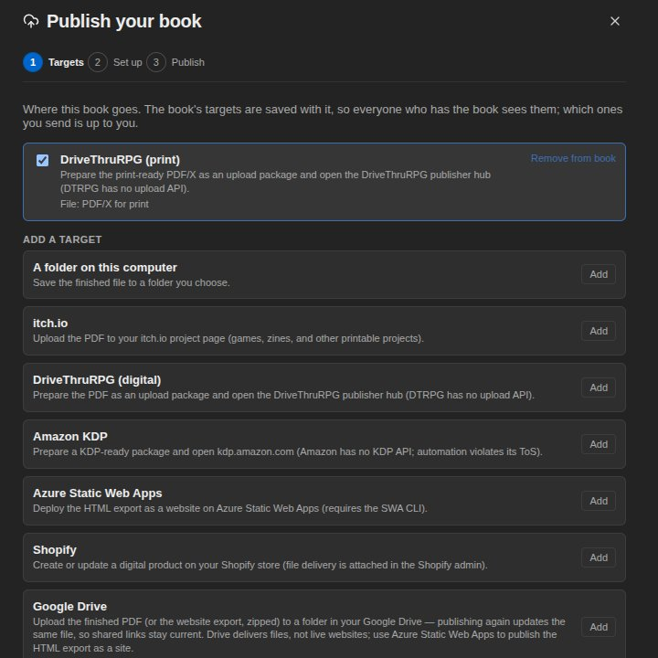

# Publish your book

Click **Publish** in the toolbar to open **Publish your book**. It has three steps: **Targets**,
**Set up** and **Publish**.

## 1. Targets

A target is a place the book goes. The book's targets are saved with it, so everyone who has the
book sees the same ones; where a book is published is the team's decision, and each person only
connects their own accounts. A new book starts with its template's targets, or its size's
(DriveThruRPG print starts with DriveThruRPG).

Each target says which file it gets. A target with a choice has a **File** menu: PDF, PDF/X for
print, or Website. The choice is saved with the book.

| Target | File | How it publishes |
| --- | --- | --- |
| A folder on this computer | PDF, PDF/X or website | Saves it in a folder (`dist` inside your book by default) |
| itch.io | PDF | Uploads it directly |
| DriveThruRPG (print) | PDF/X | Guided: Gutterpress prepares the file and opens the upload page |
| DriveThruRPG (digital) | PDF | Guided |
| Amazon KDP | PDF or PDF/X | Guided |
| Shopify | PDF or PDF/X | Uploads it directly |
| Google Drive | PDF, PDF/X or website (zipped) | Uploads it directly |
| Azure Static Web Apps | Website | Uploads it (needs Microsoft's SWA CLI) |

Each target shows whether it is **Connected**, or **Needs a key** (**Needs sign-in** for Google
Drive). **Add a target** lists the others; **Remove from book** takes one out. Untick a target to
skip it this time without removing it; that choice is yours alone, saved on this computer.

**Check the files before sending (recommended)** is ticked unless you untick it. Ticked, your book
is checked first, then each file against the rules of each target it goes to.

A book can also add targets of its own with a **publishing plugin** (experimental: it may change
or be removed). Add one under **Book setup** → **Extensions** like any extension; its row there
says **Publish destination**, and it shows under **Add a target**, marked **Experimental**.

## 2. Set up

Each target you send that has settings or needs an account is listed here. Its settings are
shared with everyone who has the book, so a teammate finds them already filled in, and they are
saved with your book when you go on. Your account is yours: it stays on your computer.

- **A folder on this computer:** the **Folder** (`dist` by default); **Choose…** picks another. A
  folder inside the book is saved with the book, so everyone saves to the same place. A folder
  outside it is yours alone, saved on this computer only, and Gutterpress asks you to confirm it
  each time you publish.
- **itch.io:** enter the **Project (user/game)** and **Channel**.
- **Shopify:** enter the **Store domain** (and optionally a product ID).
- **DriveThruRPG:** optionally paste an **Existing product URL**.
- **Azure Static Web Apps:** enter the **Environment**.
- **Google Drive:** once you are connected, pick a folder with **Choose a folder…** or make one
  with **New folder…**. The folder is where the whole team publishes, so it is saved with the
  book. Changing it later asks first: "This changes the folder for everyone who publishes this
  book." See [The book's Drive folder and your own](#the-books-drive-folder-and-your-own).
- **A publishing plugin:** there is nothing to enter here yet. It says where its settings go in
  your book's `manifest.yaml`; the plugin handles its own sign-in.

A target you send without an account is marked with a warning on **Set up** in the steps along
the top. Its file is still made, but it is not sent.

### Your account

A destination that needs an account shows the same accounts as the [Accounts](10-settings.md#accounts)
page, which is the one place accounts are managed. Pick one of your saved accounts; the choice is
remembered for this book on this computer only, so it never changes a teammate's copy.

- No account of your own yet: the form to connect one appears right in the step. Paste your
  **API key** and click **Add** (**Create a key on …** opens the page where you make one), or for
  Google Drive click **Connect Google Drive**, choose your Google account in the browser and click
  **Allow**. It is the same form the Accounts page uses, and the account is then listed there too.
- Accounts saved, but none picked for this book on this computer yet: the step says **Choose an
  account…**. Pick one, or add another.
- **Add another account…** keeps a second account, for example a studio one, under a name you give it.
- **Replace key…** (or **Sign in again…**) swaps the saved key or sign-in for the one you are using.
- **Manage accounts** opens the Accounts page to see, replace or remove an account.

Keys are stored on your computer only.

### The book's Drive folder and your own

Gutterpress can only see Drive folders that your own Google connection made or opened, so a
folder a teammate picked for the book may be out of your reach even if they shared it with you.
The Google Drive step then says so: "This book publishes to the Drive folder 'Harbor Books',
which your Google account can't reach." Choose a folder you can reach, or make one. It is saved
for you only, on this computer; the book keeps its folder for everyone else.

- If the book's folder becomes reachable later, you keep publishing to your own until you click
  **Use the book's folder**.
- **Use a different folder just for me** picks your own folder even when you can reach the book's.
- If the team changes the book's folder, or you switch accounts, your own folder no longer
  applies: you publish to the book's folder if you can reach it, or choose again.
- A book that names its folder only by name publishes to a folder of that name in each person's
  own Drive. If several of yours have that name, the step asks you to choose one, for you only.

## 3. Publish

Click **Publish**. Your book is laid out once, each file is made from that layout, checked
against the rules of each target it goes to, and sent. The step shows what it is doing, with
**Stop**. **Check only** does everything but send.

Each target then reports back:

- **Sent**, with **View it online** for an upload.
- For a guided target, the package folder (with **Show in folder**) and **Open upload page**,
  with a checklist of what to do there.
- **Held back**, when its file breaks that target's rules. The other targets still go. The
  problems are listed, with **Go to**; **Send anyway** sends it once you have decided it's fine.
- **Not sent** without an account, with **Set it up**.
- A failure, in plain words, with **Show details** and **Try again**.

Each target shows the file it got, with **Show in folder**. Problems in the book itself (content,
images, fonts) stop the run before anything is made, and are listed under **Your book** with
**Review all in Problems**. When it is done, **Done** closes the view; **Publish again** runs it
again.

The [privacy policy](https://gutterpress.dimm.city/privacy/) explains what Google Drive
publishing can access.

Next: [keep versions and back up your work](09-versions-and-backup.md).
