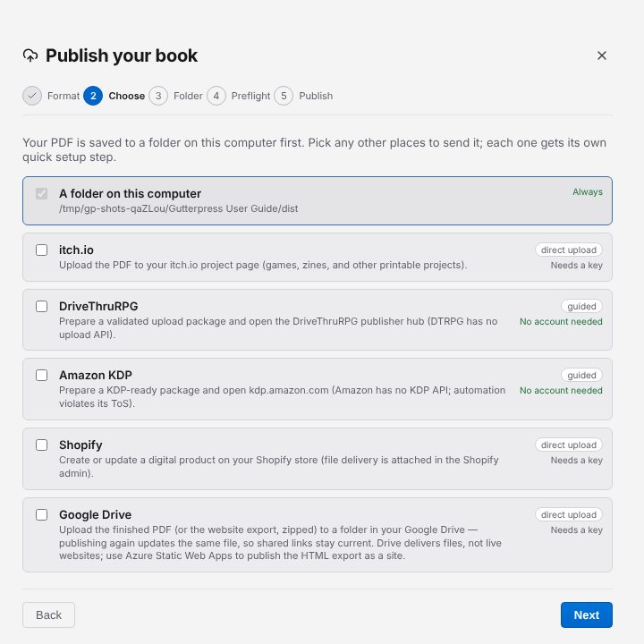

# Publish your book

Click **Publish** in the toolbar to open **Publish your book**. It walks through **Format**,
**Choose**, a step for each destination, **Preflight** and **Publish**.

## 1. Format

Choose **PDF** (a print-ready PDF) or **Website** (a folder with a standalone `book.html`).

## 2. Choose where it goes

**A folder on this computer** is always included. Tick any other destinations. The list shows
the ones that take the format you chose: Azure Static Web Apps appears for **Website**, and
Google Drive for both.

| Destination | How it publishes |
| --- | --- |
| itch.io | Uploads the PDF directly |
| DriveThruRPG | Guided: Gutterpress prepares the file and opens the upload page |
| Amazon KDP | Guided |
| Shopify | Uploads the PDF directly |
| Google Drive | Uploads the PDF, or the website as a zip |
| Azure Static Web Apps | Uploads the website (needs Microsoft's SWA CLI) |

Each destination shows whether it is **Connected**, **Needs a key**, or needs **No account**.

The places you tick are saved with the book, so everyone who opens it sees the same ones
ticked. Where a book is published is the team's decision; each person only connects their own
accounts.

A book can also add destinations of its own with a **publishing plugin** (experimental: it may
change or be removed). Add one under **Book setup** → **Extensions** like any extension; its row
there says **Publish destination**, and it shows in this list after the built-in destinations,
marked **Experimental**.

## 3. Set up each destination

Each destination you ticked has its own step. Its settings are shared with everyone who has the
book, so a teammate finds them already filled in. Your account is yours: it stays on your
computer.

- **itch.io:** enter the **Project (user/game)** and **Channel**.
- **Shopify:** enter the **Store domain** (and optionally a product ID).
- **DriveThruRPG:** optionally paste an **Existing product URL**.
- **Azure Static Web Apps:** enter the **Environment**.
- **Google Drive:** once you are connected, pick a folder with **Choose a folder…** or make one
  with **New folder…**. The folder is where the whole team publishes, so it is saved with the
  book. Changing it later asks first: "This changes the folder for everyone who publishes this
  book." See [The book's Drive folder and your own](#the-books-drive-folder-and-your-own).
- **Folder:** choose where the file goes on your computer. A folder inside the book (`dist` by
  default) is saved with the book, so everyone saves to the same place. A folder outside the
  book is yours alone: it is saved on this computer only, never in the book.
- **A publishing plugin:** there is nothing to enter here yet. The step says where its settings go
  in your book's `manifest.yaml`; the plugin handles its own sign-in.

Click **Save settings** to keep a destination's settings with your book.

### Your account

A destination that needs an account shows the same accounts as the [Accounts](10-settings.md#accounts)
page, which is the one place accounts are managed. Pick one of your saved accounts; the choice is
remembered for this book on this computer only, so it never changes a teammate's copy.

- No account of your own yet: the form to connect one appears right in the step. Paste your
  **API key** and click **Add** (**Create a key on …** opens the page where you make one), or for
  Google Drive click **Connect Google Drive**, choose your Google account in the browser and click
  **Allow**. It is the same form the Accounts page uses, and the account is then listed there too.
- Accounts saved, but none picked for this book on this computer yet: the step says **Choose an
  account…**. Pick one, or add another.
- **Add another account…** keeps a second account, for example a studio one, under a name you give it.
- **Replace key…** (or **Sign in again…**) swaps the saved key or sign-in for the one you are using.
- **Manage accounts** opens the Accounts page to see, replace or remove an account.

Keys are stored on your computer only.

### The book's Drive folder and your own

Gutterpress can only see Drive folders that your own Google connection made or opened, so a
folder a teammate picked for the book may be out of your reach even if they shared it with you.
The Google Drive step then says so: "This book publishes to the Drive folder 'Harbor Books',
which your Google account can't reach." Choose a folder you can reach, or make one. It is saved
for you only, on this computer; the book keeps its folder for everyone else.

- If the book's folder becomes reachable later, you keep publishing to your own until you click
  **Use the book's folder**.
- **Use a different folder just for me** picks your own folder even when you can reach the book's.
- If the team changes the book's folder, or you switch accounts, your own folder no longer
  applies: you publish to the book's folder if you can reach it, or choose again.
- A book that names its folder only by name publishes to a folder of that name in each person's
  own Drive. If several of yours have that name, the step asks you to choose one, for you only.

## Preflight

Preflight checks the book before anything is sent. It reports **All clear — ready to publish.**,
things to review, or problems to fix; **Go to** takes you to each one, and **Re-run** checks
again. You can still **Publish anyway**. The PDF itself is checked once it is built — see
[Save a PDF](07-export-pdf.md).

## 4. Publish

Click **Publish** (or **Save** if only the folder is ticked). Each destination reports back:
**Show in folder** for your copy, **View it online** for an upload, and for guided destinations
**Open upload page** with a checklist of what to do there.

The [privacy policy](https://gutterpress.dimm.city/privacy/) explains what Google Drive
publishing can access.

Next: [keep versions and back up your work](09-versions-and-backup.md).
