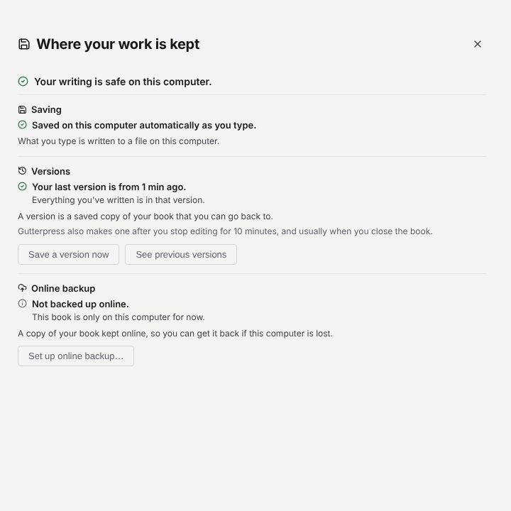
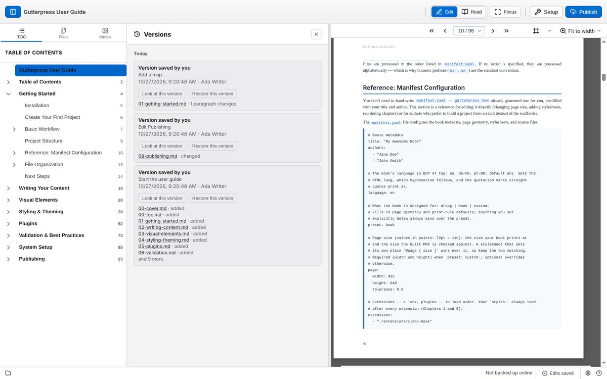

# Keep versions and back up your work

## Where your work is kept

The indicator in the status bar shows whether your edits are saved: **Edits saved**,
**Saving…**, **Unsaved changes** or **Couldn't save**. Click it to open **Where your work is
kept**, which has three parts:

- **Saving** — **Save now** saves immediately.
- **Versions** — **Save a version now** keeps a copy of the book as it is, and **See previous
  versions** lists them. If the book is a plain folder, **Start keeping versions** turns this on.
- **Online backup** — **Back up now** copies your versions to your online backup.

Next to the indicator, a status shows the online backup: for example **Backed up online**,
**Backing up…**, **Not backed up online**, or **Offline — edits are saved on this computer**.

## See what each version changed

Click the save indicator, then **See previous versions**, to open **Versions**. Each version
shows when it was made and what it changed: a short list of files with a plain hint, such as
`chapter-02.md · 3 paragraphs changed`, `styles/book.css · 1 rule changed` or
`art/cover.png · replaced`. An automatic version that changed nothing says **No changes**.
When the book has an online copy, each version also says **Backed up** or **On this computer
only**.

- **Look at this version** shows that version beside the current book in the preview, on the
  same page, so you can compare them as they print. Nothing on disk changes. Click **Stop
  looking** (or the **×** in the preview's bar) to return to the live preview.
- Click a changed file to see **That version** and **Current** side by side, with the lines that
  differ marked. This view is for reading only; go back to the versions list with the
  **Versions** button at the top.
- In a narrow window there is room for one page at a time: the bar above the preview offers
  **That version** and **Current book**.
- When new changes are online that this computer has not got, the list starts with **Online,
  not yet on this computer**, showing those versions and their changed files. Use **Get
  latest** to bring them in.

## Go back to an earlier version

1. Open **Versions** as above.
2. Find the version you want and click **Restore this version**.
3. Confirm with **Yes, restore**. Gutterpress saves your current work as a version first, so
   nothing is lost.

## Back up online

Online backup keeps a copy of your book's versions on GitHub (or another Git server).

1. Connect your account: Settings → **Accounts** → **GitHub** → **Connect GitHub…**, then enter
   the code shown on the GitHub page.
2. A book that already has an online copy, such as one you opened with
   [Open from GitHub](02-books.md#open-a-book-from-github), backs up as soon as you are connected.
   **Setup → Connections** shows its folder, online repository and branch.
3. A book you started on this computer needs an online copy first. See
   [Set up online backup for a book you started here](#set-up-online-backup-for-a-book-you-started-here).

### Set up online backup for a book you started here

You need a connected GitHub account (step 1 above) and version history turned on for the book.

1. Click the save indicator, then **Set up online backup…** under **Online backup**. This opens
   **Setup → Connections**.
2. If the book is a plain folder, click **Turn on version history** first. Online backup copies the
   versions Gutterpress keeps, so it needs them.
3. Under **Set up online backup**, choose where the copy goes:
   - **Create a new repository** — the name starts as your book's title and you can change it.
     **Keep it private (only you can see it)** is on by default.
   - **Use an empty repository I already made** — pick one from the list. Repositories that look empty
     are listed. To make one, click **Open github.com to create one…** and leave "Add a README"
     off.
4. Click **Set up online backup**. Gutterpress connects the book to the repository and copies all
   of its earlier versions there. When it finishes, the status bar shows **Backed up online** and
   the book works like one opened from GitHub.

If something goes wrong, Gutterpress says what happened in plain words and leaves your book as it
was. The common cases:

- **A repository with that name already exists** — pick another name, or choose that repository
  from the empty ones.
- **The repository already has files** — online backup needs an empty one. Choose another, or
  create a new one.
- **No internet connection** — nothing was changed; try again when you are back online.
- **GitHub didn't accept the saved connection** — reconnect under Settings → **Accounts**, then try
  again.
- **The copy didn't go through after the repository was created** — the empty repository is kept
  and selected; click **Try again** to use it.

Settings → **Saving** has the switches: **Save edits automatically**, **Keep previous versions**
and **Keep this book backed up online**.

### Get and send changes yourself

To get changes from online and send yours only when you choose, turn off **Keep this book backed
up online**. The status bar then shows two buttons next to the online status:

- **Get latest** brings in the changes from online and sends nothing back. Your own edits stay
  on this computer.
- **Back up now** gets the latest first, then sends your changes.

Both buttons are also in **Where your work is kept**. While automatic backup is off, Gutterpress
checks for new changes online every few minutes and when you come back to the window. When it
finds some, a message says **New changes are online for this book**, with a **Get latest**
button.

### When your changes and the online copy overlap

If you and someone else edited the same passage, getting the latest changes keeps both versions
in the file and tells you so: **Two versions of a passage were kept in chapter-02.md — yours and
the online version. Choose which to keep in the editor**, with a **Review** button. Nothing is
lost, but the book will not export until you choose.

1. Click **Review**, or open the Problems list from the editor toolbar. Each passage with two
   versions is listed as **Two versions**; click one to open its file.
2. A card above the text asks, one passage at a time, which version you want to keep: **Keep
   yours**, **Keep online** or **Keep both**. The editor scrolls to that passage, and the preview
   shows both versions in the page, each in a labelled box, so you can read either one as it
   would print. **Compare the text** shows the two texts in the card. With several passages, the
   count and arrows in the card's corner move between them.
3. Click your choice. The file is updated right away, the card moves on to the next passage, and
   a message confirms it with an **Undo** button.

Undo in the text (Ctrl+Z, or Cmd+Z on a Mac) also brings both versions back. Stylesheets work
the same way, rule by rule.

A picture or other file that cannot hold two versions is kept as two files instead, the online
one named `cover.online.png` beside your `cover.png`. Keep the one you want and delete the other
from the Files list.

Next: [settings, updates and getting help](10-settings.md).
