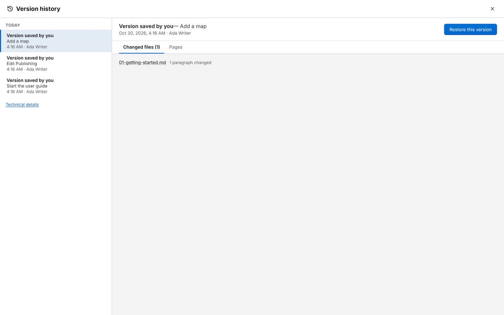
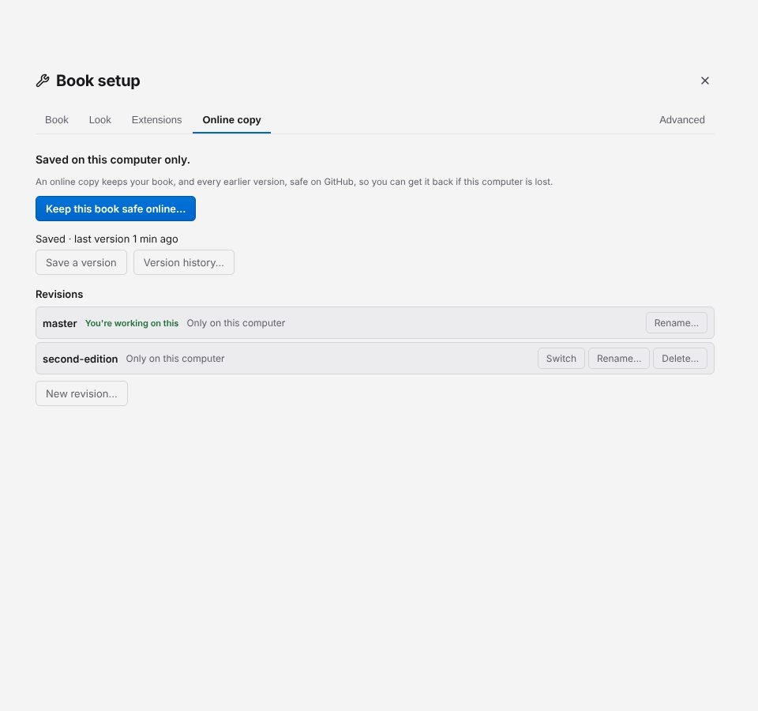

# Keep versions and back up your work

## The status control

The status bar has one status control, on the left after the book switcher. It shows whether your
edits are saved and where the book
stands in its online copy: **Saving…**, **Saved on this computer**, **Saved · Backed up**,
**Saved · Backing up…**, **Saved · Not backed up yet**, **Saved · Offline — backs up when you're
back**, **Saved · Sign in to back up**, **Saved · Backing up paused**, **Unsaved changes**,
**Couldn't save** or **Versions need attention**. A shape beside the words (a check, a cloud, a
warning) says the same thing without colour.

Click it to open **Setup → Online copy**, the one place for everything below. It has three
cards:

- **Status**, at the top: where the book is kept, in one line, with the one next step beside it.
- **Revisions**: the book's separate lines of work (see [Revisions](#revisions)).
- **Version history**: every version of the revision you're working on, with **Save a version**
  in its header to keep the book as it is now.

If the book is a plain folder, the status card offers **Turn on version history** instead. **Save now**
stays on Ctrl+S (Cmd+S on a Mac) and the editor's Save button.

## See what each version changed

Click the status control: **Version history** is the last card in **Setup → Online copy**, with
**Save a version** in its header. Each version shows when it was made and what it changed: a
short list of files with a plain hint, such as `chapter-02.md · 3 paragraphs changed`,
`styles/book.css · 1 rule changed` or `art/cover.png · replaced`. An automatic version that
changed nothing says **No changes**. The first version of a book is labelled **First version**.
When the book has an online copy, each version also says **Backed up** or **Only on this
computer**.

- **Look at this version** closes Setup and shows that version beside the current book in the
  preview, on the same page, so you can compare them as they print. Nothing on disk changes. Click
  **Stop looking** (or the **×** in the preview's bar) to return to the live preview.
- Click a changed file to see **That version** and **Current** side by side, with the lines that
  differ marked. This view is for reading only; go back to the versions list with the
  **Version history** button at the top.
- In a narrow window there is room for one page at a time: the bar above the preview offers
  **That version** and **Current book**.
- When new changes are in the online copy that this computer has not got, the list starts with
  **In the online copy, not yet on this computer**, showing those versions and their changed
  files. They come in on their own while Gutterpress backs up automatically, or when you choose
  **Sync**.

## Go back to an earlier version

1. Open **Version history** as above.
2. Find the version you want and click **Restore this version**.
3. Confirm with **Yes, restore**. Gutterpress saves your current work as a version first, so
   nothing is lost.

## Your online copy

An online copy keeps your book and all its versions on GitHub (or another Git server). It backs up
on its own, and changes your collaborators make arrive on their own. **Setup → Online copy** says
in one line where the book is kept, and offers the one next step:

- **Version history is off for this book.** The book is a plain folder. Click **Turn on version
  history** to keep earlier versions on this computer. Nothing is uploaded.
- **Saved on this computer only.** The book has versions but no online copy yet: see
  [Set up an online copy for a book you started here](#set-up-an-online-copy-for-a-book-you-started-here).
- **This book's online copy is on GitHub: …. Sign in to back it up.** Click **Sign in…** and
  enter the code it shows on the GitHub page that opens (**Copy code** copies it; **Open GitHub
  again** reopens the page). The book backs up as soon as you are signed in. A book you opened with
  [Open from GitHub](02-books.md#open-a-book-from-github) is already signed in.
- **This book's online copy is on git.example.com. Sign in to back it up.** See
  [Back up to another Git server](#back-up-to-another-git-server).
- **Backed up · 2 mins ago**, **Not backed up yet**, or **Online copy: ….** The book can back up.
  Once a pass has run, the line says how it went: **Backed up** when it sent your work (or there
  was nothing to send); **Not backed up yet** when this computer has versions the online copy
  lacks; **Couldn't reach …** when the server can't be reached; or **Couldn't back up to …**
  with the reason. The last two offer **Try again** (when the server no longer accepts the saved
  sign-in, the sign-in step comes back instead). With automatic backing up off, it says so and
  offers **Sync now**, which gets the latest changes and then backs up yours.
- **This book's online copy uses an SSH address (git@…).** Gutterpress can't back up over SSH.
  Keep backing up with your usual Git tool, or give the book its https:// address with that tool
  (`git remote set-url origin https://…`) and come back to sign in.

GitHub and other Git servers can also be signed in to, edited and removed on the
[Accounts](10-settings.md#accounts) page, which lists every account saved on this computer.

### Revisions

A revision is a separate line of work in the same book: a "Second edition", an "Editor's pass".
**Setup → Online copy** lists the book's revisions under **Revisions**. Each row has the
revision's name, says **You're working on this** for the open one (always first; the rest follow
by name), and says where it is kept:

- **Online** — on this computer and in the online copy.
- **Online · not backed up yet** — this computer has versions the online copy hasn't.
- **Only on this computer** — never backed up.
- **Only online** — in the online copy, not on this computer yet.

The card shows five revisions, the open one first; **Show all** lists the rest. With more than five,
a **Find a revision** field above the list narrows it as you type.

Each row has **Switch** (except the open one) and a **⋯** menu with **Rename…** (every revision)
and **Delete…** (every revision but the open one). Rename, Delete and New revision each open a
small dialog that says what will happen before it happens:

- **Switch** opens another revision. Gutterpress first saves any work not in a version yet, and
  the editor, the file tree and the preview show the revision you switched to. A revision that is
  only online is made on this computer first.
- **Rename…** renames it. For an online revision it also renames it in the online copy, right away
  (anyone else working on it keeps the old name until they switch to the new one); a revision that
  is **Only online** is renamed in the online copy. If the online copy has versions this computer
  doesn't, it asks you to get the latest changes first.
- **Delete…** deletes a revision you are not working on. For an online revision you choose
  **Delete on this computer only** or **Delete everywhere**. A revision that is **Only online** is
  deleted from the online copy, after you confirm; if it changed online since the list was
  checked, nothing is deleted and Gutterpress asks you to try again. If the revision holds
  versions that are in no other revision, Gutterpress says how many would be lost and asks once
  more.

**New revision**, in the card's header, asks for a name (spaces become hyphens), starts the revision
from your book as it is now (saving any work not in a version yet first), and opens it. It goes
online the next time you back up. If the online copy can't be checked, the list says so and shows
the revisions on this computer.

### Set up an online copy for a book you started here

1. Click the status control, then **Keep this book safe online…**. This opens **Setup → Online
   copy**.
2. If the book is a plain folder, click **Turn on version history** first. The online copy holds
   the versions Gutterpress keeps, so it needs them.
3. Click **Connect GitHub…** if GitHub isn't signed in yet, and enter the code shown on the GitHub
   page that opens.
4. Choose where the book goes:
   - The **Name of the online copy** starts as your book's title and you can change it. **Private:
     only you can see it** is on by default.
   - Or click **Use an empty one you already made on GitHub** and pick one from the list. Empty
     online copies are listed. To make one, click **Open github.com to create one…** and leave "Add
     a README" off (GitHub calls it a repository).
5. Click **Back up to GitHub**. Gutterpress sends the book and all its earlier versions to the
   online copy. When it finishes, the status bar shows **Saved · Backed up** and the book works
   like one opened from GitHub.

If something goes wrong, Gutterpress says what happened in plain words and leaves your book as it
was. The common cases:

- **An online copy with that name already exists** — pick another name, or choose that one from the
  empty ones.
- **The online copy already has files** — an online copy needs an empty one. Choose another, or
  create a new one.
- **No internet connection** — nothing was changed; try again when you are back online.
- **GitHub didn't accept the saved sign-in** — sign in again with **Sign in again…** beside GitHub
  on the [Accounts](10-settings.md#accounts) page, then try again.
- **Sending the book didn't finish after the online copy was created** — the empty online copy is
  kept and selected; click **Try again** to use it.

Settings → **Saving** has the switches: **Save changes automatically**, **Keep version history**
and **Back up online automatically**.

### Back up to another Git server

Gutterpress also backs up to GitLab, Gitea, Forgejo, Bitbucket, Azure Repos and other Git servers,
over their https:// address. It doesn't create online copies there, so the book starts from one
that already exists on the server:

1. Put the book on your server with your usual Git tool, or download one that is already there.
2. Open the book's folder in Gutterpress, then **Setup → Online copy**. It names the server the
   book's online copy is on.
3. Create an access token on that server, paste it under **Access token** (with your **Username**
   if the server needs one) and click **Sign in**. The token is checked with the server before it
   is saved. For a server Gutterpress recognises, **Create an access token on …** opens the page that
   makes one; for any other, **How to make an access token** opens this section.

To save a server's token before you open a book, use **Add a Git server…** under **Other Git
servers** on the [Accounts](10-settings.md#accounts) page; **Edit** there replaces it later.

Where each server makes its tokens:

- **Gitea or Forgejo:** Settings > Applications.
- **GitLab:** Preferences > Access tokens, with read and write access to repositories.
- **Bitbucket:** Personal settings > App passwords, with repository read and write.
- **Azure Repos:** User settings > Personal access tokens, with Code read & write.

### If backing up keeps failing

Once a book's online copy can back up, the status card in **Setup → Online copy** ends with a
collapsed **Backing up keeps failing?**, with these tools:

- **Test connection** checks that Gutterpress can reach this book's online copy. Nothing is changed
  or uploaded.
- **Sign in again** opens the [Accounts](10-settings.md#accounts) page, for a book on GitHub.
- **Repair the online copy** replaces this book's versions with a fresh download from the online
  copy. Your files stay as they are and win; files only the online copy has come back. The old
  versions are kept aside in the app's data folder, then a version is saved and backed up.
- **Start over from the online copy** is the last resort. It keeps a safety folder with everything
  as it is now, downloads a fresh start from the online copy and puts your files back on top. The
  book closes at the end: open it again and back up.

Repair and Start over each ask once more before they run. If GitHub stopped accepting your
sign-in, use **Sign in again…** beside GitHub on the Accounts page; its **Test sign-in** checks
the sign-in itself, while **Test connection** here checks this book's online copy.

### Get and send changes yourself

To get changes from the online copy and send yours only when you choose, turn off **Back up
online automatically** in Settings. The status bar then shows a **Sync** button next to the
status. **Sync** gets the latest changes from the online copy, then backs up yours.

**Sync now** in **Setup → Online copy** does the same. While automatic backing up is off,
Gutterpress checks for new changes in the online copy every few minutes and when you come back to
the window. When it finds some, the **Sync** button is highlighted and a message says **New changes
are online for this book**, with a **Sync** button. In Reader mode none of this shows: a reader
gets the latest changes on their own.

### When your changes and the online copy overlap

If you and someone else edited the same passage, getting the latest changes combines both sides in
the file and tells you so: **Two takes of a passage were kept in chapter-02.md — yours and the
online copy's. Choose which to keep in the editor**, with a **Review** button. Nothing is lost,
but the book will not export until you choose.

1. Click **Review**, or open the Problems list from the editor toolbar. Each passage with two
   takes is listed as **Two takes**; click one to open its file.
2. A card above the text asks, one passage at a time, which take you want to keep: **Keep
   yours**, **Keep online** or **Keep both**. The editor scrolls to that passage, and the preview
   shows both takes in the page, each in a labelled box, so you can read either one as it
   would print. **Compare the text** shows the two texts in the card, with the words only one
   side has marked (two takes that differ only in spacing say so). With several passages, the
   count and arrows in the card's corner move between them.
3. Click your choice. The file is updated right away, the card moves on to the next passage, and
   a message confirms it with an **Undo** button. **Keep both** puts your take first and the
   online copy's take after it, as two paragraphs.

When the last passage in a file is settled, a message offers the **Next file** that has one.
Undo in the text (Ctrl+Z, or Cmd+Z on a Mac) also brings both takes back. Stylesheets work
the same way, rule by rule, and so does the book's settings file: while `manifest.yaml` holds
two takes of a setting the preview shows **This book's settings have two takes** instead
of a page, and comes back on its own once you choose.

If a passage's two texts look nothing alike, someone online may have rewritten or removed
paragraphs above it, so the two sides are offset by a paragraph from there on. Keep the same
side all the way down the chapter, or keep both and tidy the text afterwards.

A picture or other file that cannot hold two takes is kept as two files instead, the online
one named `cover.online.png` beside your `cover.png`. Keep the one you want and delete the other
from the Files list.

Next: [settings, updates and getting help](10-settings.md).
