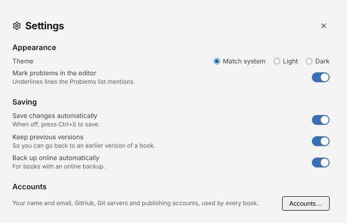

# Settings, updates and getting help

The gear at the right of the status bar (or Ctrl+, — Cmd+, on a Mac) opens **Settings**, and so
does the **Settings** button at the top of the start screen; the **?** next to the gear opens
**Help**, a tab of the start screen.

## Settings

Settings is one page, the same whether a book is open or not. Every change applies at once: there
is nothing to save. **Reset** beside a group's name puts that group's settings back to how they
were when you installed the app.

- **How you use Gutterpress** — **Reader** or **Author**. A new install starts as a **Reader**:
  just the pages, with Edit, Setup and Publish out of the way, and only the table of contents in
  the left panel. **Author** is for writing and setting up your book, then publishing it. Creating
  a book switches you to Author.
- **Appearance** — the **Theme** (**Match system**, **Light** or **Dark**), and the **Preview
  background**, the colour around the pages in the preview.
- **Preview** — the **Default zoom** a book opens at (**Fit to width** or 25%–200%; choosing a zoom
  in the preview changes it too); **Right-click menu in the preview**, on unless you turn it off
  (it also stops **Shift+F10** opening the menu); the **Print overlay strength** (**Subtle**,
  **Normal** or **Strong**); and a colour for each print overlay: **Bleed**, **Safe area: text**,
  **Safe area: art** and **Page margins** (see
  [Check the print overlays](03-write-and-preview.md#preview)). Its **Reset** also puts back the
  preview's other remembered choices: Edit or Read, one page or two, the print overlays and the
  width of the editor beside the preview.
- **Editor** — **Mark problems in the editor**, which underlines the lines the Problems list
  mentions.
- **Saving** — **Save changes automatically** (when it's off, press Ctrl+S to save), **Keep
  version history** and **Back up online automatically** (see
  [Keep versions and back up your work](09-versions-and-backup.md)).
- **Accounts** — **Accounts…** opens the [Accounts](#accounts) page, where your name and email
  and every account Gutterpress uses are kept.

## Accounts

The **Accounts** page is the one place for who you are and every account Gutterpress connects to.
They are saved on this computer, and every book uses them. Open it with the **Accounts** button at
the top of the start screen, or **Accounts…** in Settings; the **Add your name & email** notice
over a book opens it with the cursor in **Name**.

Each group lists what is saved, and has one **Add** button that opens a small form in place. Click
**Edit** beside a saved account to replace its token or key. For safety a saved token is never
shown, so paste the new one again; it is cleared from the page as soon as it is saved. **Remove**
asks once more before it deletes an account.

- **Your name and email** — saved with each version, so the version history shows who changed what.
  Left empty, a version uses the name and email already set for Git on this computer, or else
  "gutterpress". They save as you type, and **Reset** empties both.
- **GitHub** — **Connect GitHub…** signs you in. Once you are connected, **Test sign-in** checks
  that GitHub still accepts your sign-in, **Sign in again…** signs you in again (do this when
  backing up stops with a sign-in error) and **Disconnect** removes it.
- **Other Git servers** — GitLab, Gitea, Forgejo, Bitbucket, Azure Repos or any server with an
  https:// address. **Add a Git server…** asks for the **Server address**, your **Username** if
  the server needs one and an **Access token**; the token is checked with the server before it is
  saved. Once you type the address of a server Gutterpress recognises (Gitea, Forgejo, GitLab,
  Bitbucket or Azure Repos), **Create an access token on …** opens that server's own page for
  making one; for any other, **How to make an access token** opens
  [the guide](09-versions-and-backup.md#back-up-to-another-git-server), which lists where each
  server makes one. **Edit** replaces the username and token. A book whose online copy is on that
  server then backs up with them.
- **Publishing** — a key for each destination that takes one (itch.io, Azure Static Web Apps and
  Shopify), and your Google Drive sign-in. **Add a publishing account…** asks which one, then for
  its **API key** (**Create a key on …** opens the page that makes it) and, if you want to keep
  more than one for the same destination, an **Account name**. The key is checked with the
  destination before it is saved. For Shopify, also enter your **Store address**
  (`your-store.myshopify.com`): it is used for the check only and not saved, because each book
  keeps its own store in its Publish settings. For Google Drive, **Connect Google Drive** opens your
  browser to choose your account and click **Allow**; **Sign in again…** does it again. You can also
  add a key from a book's [Publish](08-publish.md) steps, with this same form. Which account a book
  publishes with is picked there and remembered on this computer only; the book itself never names
  your account.

An account that says **Needs signing in again** can no longer be read (this happens when the computer's
keychain changes): **Edit** it, or **Sign in again…** for Google Drive, to save it again.

## Updates

Gutterpress checks for updates itself and shows **Update available** with a **Download** button,
then **Update ready — Restart & update** once it has downloaded. On a Mac, the update downloads
from GitHub for you to install. To check yourself, open the start screen's **Troubleshooting** tab,
then **Diagnostics**, and click **Check now** beside the version you're running.

The channel menu beside **Check now** is **Stable — recommended** unless you choose **Beta** or
**Alpha** for early builds. On Linux, Diagnostics also has **Add to application menu**, which adds
the AppImage to your desktop's menu.

## Get help or report a problem

The start screen's **Help** tab has help on using the app, and these guides are always at
[gutterpress.dimm.city/docs](https://gutterpress.dimm.city/docs/).

To report a problem, open **Troubleshooting → Report a problem** and answer its questions: a
short summary, what happened, what you expected, and the steps that show it. **Open GitHub
issue** opens the issue form with your answers, your app and system versions, how the book is
set up (not its text) and the end of the app's log already filled in; nothing is sent until you
create the issue. On GitHub, drag any screenshots or sample files into **Screenshots or files**,
since the app can't attach them for you. **Copy report** copies the same details. Error messages
also offer **Report a problem**. The **Logs** and **Diagnostics** tabs help when something isn't
working, and with a book open, **Open terminal in book folder** on the **Diagnostics** tab opens
a terminal there (bash; on Windows, a Command Prompt when bash isn't installed).
