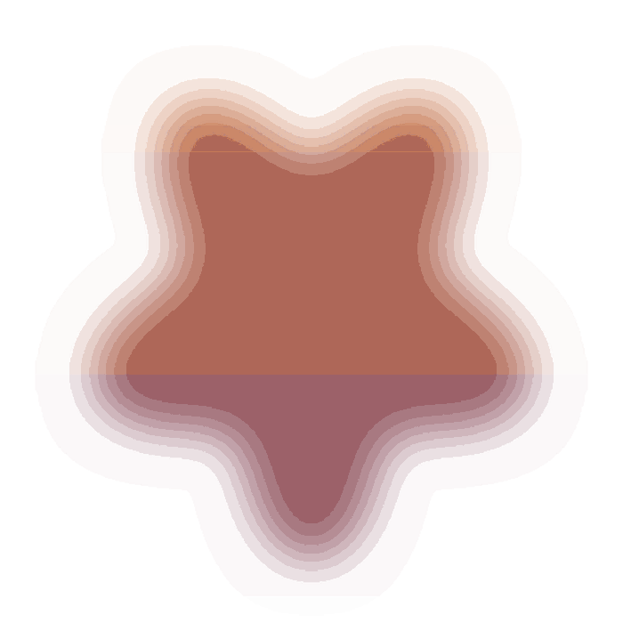

@page

## Soft shadow

@section
This card floats over a brick wall on a soft, blurred `rgba()` shadow. A soft
shadow is real transparency, which PDF/X-1a cannot carry, so Gutterpress
flattens this page's artwork (the wall, the card and its shadow) to a picture
and keeps the words you are reading as live, searchable text in an embedded
font.
@end-section

@page

## Clipped shape

@section
A polygon card with a shadow that follows its outline. The shadow is a
separate, clipped layer filled with a translucent colour, so the cut corners
show the wall through them instead of leaving a square shadow behind. The
translucent fill is transparency too: the artwork is flattened, the text is
not, and you can still select every word on this page.
@end-section

@page

## Cutout art

A soft-edged cutout image with an alpha channel sits beside this paragraph.
The picture's feathered edge blends into the wall, which only works with
transparency, so the page is flattened for PDF/X. The artwork becomes one
picture; the text next to it stays a font, not a bitmap, and prints from the
black plate alone.

{.gp-pin .gp-right .gp-top .gp-size-30}

@page

## Translucent panel

@section
A frosted panel sits behind this text. Its background is a translucent white,
so the wall shows faintly through it. Translucent fills are everywhere in
modern CSS, and each one used to cost a page its text in a PDF/X build. Here
the page is flattened to a picture and the text on it is kept as live text.
@end-section

@page

## Control page

This page uses no transparency at all, so it passes through the PDF/X
conversion as ordinary vector artwork and text, exactly as it always did.
Only pages that need flattening are flattened; this one is left alone, which
is why its rules and shapes stay crisp vectors at any zoom.
