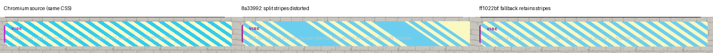

# Full Field Guide rerun on ff1022bf

Tested PR #388 at `ff1022bf061e18a10afeaf4e15414f3bd0cd3c1e` on October 14, 2026. The combined, isolated, and boundary CSS sweeps all use the **full 228-page Field Guide** in this run. This supersedes the earlier report's limitation that the new gradient guard had only been checked on extracted pages. The historical boundary run had only 28 source pages and seven converted sample pages; its extension to the full book here is intentional.

Book base `11ddc736`, `gp-dimm-city@1.6.3`, unchanged manuscripts/extension/CSS sweep files; Chromium 155.0.8059.39, Ghostscript 10.06.0, Bun 1.4.1. PDF/X-1a with CGATS21_CRPC1, DTRPG configuration and preserve-text enabled. The experimental single-face Lixdu weight-range declaration remains a test control, not a production font fix.

## Full-book results and checks

All six source/final PDFs have 228 pages. Every source/final page box matches. All three final PDFs have **zero live transparency**, all listed fonts embedded, and no unexpected page losing all its text.

| Sweep | Transparent source pages | Split / fallback | Pages with live text, source → final | Source → final size (decimal MB) |
|---|---:|---:|---:|---:|
| Combined | 225 | 213 / 12 | 217 → 205 | 92.27 → 235.46 |
| Isolated | 25 | 21 / 4 | 215 → 211 | 77.26 → 45.16 |
| Boundary | 225 | 222 / 3 | 215 → 212 | 77.28 → 191.26 |

Fallback pages: **combined 2, 5, 7, 8, 10, 12, 14, 15, 18, 138, 159, 192; isolated 10, 15, 18, 19; boundary 14, 15, 17**. Loss of live text is exactly confined to these pages. The combined output grows from the prior 230.70 MB to 235.46 MB, with p14 newly falling back.

- Independent `qpdf --check` exits 0 for each full output. The latest PR CLI passes all eight selected check IDs: structure, page size, bleed, font embedding, transparency, color spaces, PDF/X metadata, and PDF/X markers. It reports 14 executions because some checks run more than once; these are not 14 distinct properties.
- Independent PDF.js operator checks match the exact ordered Unicode glyph sequence and inventory on **216 combined + 224 isolated + 225 boundary = 665 nonfallback pages**. There are zero mismatches. Small Poppler extraction differences remain, but do not represent missing/added operator glyphs.
- Focused tests (`pdf-inspect`, `ghostscript`, `exec`, `printsafe`): **92 passed, 9 fixture-dependent skips, 0 failed**, 296 expectations. See [test log](unit-tests.log).
- [Summary and full-file hashes](summary.json), [independent audit](independent-validation-summary.json), [combined check result](combined/validation.json), [isolated check result](isolated/validation.json), [boundary check result](boundary/validation.json). Each sweep folder also contains its applied CSS, build log, font list, qpdf result, page-by-page analysis, and glyph audit.

## Visual regression coverage

Poppler renders at 720 pixels high were compared against the earlier `8a33992` artifacts:

| Sweep | Source comparison | Final PDF/X comparison |
|---|---|---|
| Combined | All 228 pages identical | 227/228 identical; only p14 changes, correcting the repeating-gradient failure |
| Isolated | All 228 pages identical | All 12 previously saved sample pages identical |
| Boundary | 25/26 comparable content pages identical; p2 now resolves TOC references because the whole book is present | 4/7 old sample pages identical; p14 now uses conservative gradient fallback; p15/p17 have tiny raster variations with no visible layout/content defect found |

The old boundary's two signature-padding pages were excluded from the source comparison. At 552×720 pixels, boundary p15 differs in 553/397,440 pixels (0.139%, mean absolute channel difference 0.00455/255) and p17 in 95/397,440 (0.024%, 0.000537/255). These small differences are recorded rather than called pixel-identical; [side-by-side p15](boundary/previews/regression-p015.png), [p17](boundary/previews/regression-p017.png), and [TOC input change](boundary/previews/regression-source-p002.png) were inspected directly. See [complete pixel results](visual-regression.json) and [difference details](boundary/pixel-change-details.json).

Source/final pairs at 1200 pixels high were personally inspected on **31 specimen/control pages**: combined 1,4,8,12,13,14,17,138,159,192,200; isolated 2,5,7,8,9,10,13,15,17,18,19; boundary 8,13,14,15,17,18,19,138,200. All 684 final pages have contact-sheet renders; the detailed visual claims are limited to the inspected specimens and automated comparisons, not a press-resolution examination of every mark.

The boundary controls retain their outcomes: geometric glyph clipping and image-only screen blending survive; `.9999` triggers whole-page fallback; `.999999` is quantized to opaque in this Chromium specimen and retains live text; `opacity:0` removes the heading in both source and final while body text remains live. The `.999999` value is not a portable workaround.

## Downloadable proof



- Repeating-gradient p14: [source PDF](combined/p14-pdf.pdf), [latest output page](combined/p14-pdfx.pdf), [source/final comparison](combined/previews/compare-p014.jpg).
- Conic-gradient p14: [source PDF](boundary/p14-pdf.pdf), [latest output page](boundary/p14-pdfx.pdf), [source/final comparison](boundary/previews/compare-p014.jpg).
- Real-bold stroke p15: [source PDF](isolated/p15-pdf.pdf), [latest output page](isolated/p15-pdfx.pdf), [source/final comparison](isolated/previews/compare-p015.jpg), [font/glyph evidence for p15 and p18](isolated-stroke-proof.jsonl).
- Remaining limits and preserved effects: [opaque foreground cover](combined/previews/compare-p004.jpg), [foreground tint](combined/previews/compare-p013.jpg), [SVG pattern](combined/previews/compare-p138.jpg), [SVG alpha gradient](combined/previews/compare-p159.jpg), [geometric clipping](boundary/previews/compare-p008.jpg).

The six downloadable PDFs are page extracts of the validated full outputs or their sources. All six match their full-PDF page pixel-for-pixel at 1200px high ([extraction check](proof-extraction-check.json)). They preserve page content, but the `qpdf --empty` extraction does not retain the full book's catalog metadata/output intent; they are visual proof files, not separately certified PDF/X documents.

## What the new build changes

- **Repeating-gradient corruption is fixed for the tested transparent page.** Combined p14 now bypasses splitting and retains uniform diagonal stripes through whole-page fallback. Its text is consequently rasterized. The former broad gaps and irregular stripes are absent in the new full-book output.
- **The SVG guard still works.** Combined p138's pattern wordmark and p159's alpha-gradient wordmark remain visible, with whole-page fallback as expected.
- **Per-page fallback reasons now appear in the build log.** This addresses the previous request to explain why a particular page loses live text. The reason is the first detected cause, not a complete list of every effect on the page.
- **The foreground-ordering limitation remains.** Combined p4 reveals text beneath an opaque cover; p13 no longer tints text beneath its translucent foreground overlay. These are documented design limitations and reproduce the earlier output, not new rendering regressions.

The updated [combined-case ledger](cases-latest.json) records the latest outcomes; [the earlier full style matrix](../report.md#styling-outcomes) supplies the original controls and confounds. The gradient rows are superseded by this report.

The gradient result is specific to these pages, which also contain transparency. The guard excludes them from the artwork/text split and leaves them to normal Ghostscript conversion; it is not a general gradient-rendering repair and does not establish opaque-only gradient support.

## Diagnostics to correct

1. `build-runner.ts:844–845` says the detected gradient **“will print blank”** even when the same build successfully preserves it via fallback. The CSS lint message in `printsafe.ts:486` makes the same unconditional assertion. Keep the risk warning, but qualify it by conversion path/version and state the selected fallback path and whole-page text-loss consequence where known. Do not infer guaranteed blank output solely from a FunctionType4 shading being present.
2. `build-runner.ts:893` recommends **“use a font face with a real bold”** for every Type 3 page, including text strokes. Isolated p15 and p18 already use real `Tomorrow-Bold` and still produce Type 3 glyphs. Advise removing/changing text strokes or accepting fallback for that case; reserve the real-weight recommendation for synthetic bold.

These are actionable diagnostic defects, not new failures of the rendered output. The split/fallback approach remains appropriate as an explicit opt-in for backgrounds and artwork beneath opaque text. It cannot preserve arbitrary foreground compositing, and a single nonopaque glyph/card can still rasterize an entire page.

## Recommendations

- Keep the shading guard before splitting and retain real repeating-gradient, conic-gradient, and SVG-pattern fixtures. Compare rendered pixels as well as text: glyph retention cannot catch incorrect artwork.
- Keep conservative conic fallback documented. It trades away live text on a specimen that previously rendered correctly on this Ghostscript version.
- Correct the two diagnostic messages above and keep the page/reason report. Explain that reported reasons are representative when more than one cause applies.
- Keep preserve-text opt-in, explicitly document the text-on-top constraint, and use faithful whole-page output for covers, tints, text effects, or other compositions that depend on paint order.
- Resolve the production font-weight mismatch upstream. Do not ship the lab's all-weights Lixdu declaration as a typography fix.
- Document the file-size, fine-rule rasterization, and transparency-scope costs. One image/text blend can make Chromium wrap much more of the book in transparent groups.

## Reproduction

Start with the original [book overlay](../reproduction/book/) on `dimm-city/dc-op-manual@11ddc736`, then replace `tools/pdfx-stress/{run.py,compare.ts,combined.css,isolated.css,boundary.css}` with this packet's [reproduction files](reproduction/). Use a dependency-installed Gutterpress checkout at the pinned PR commit. Run the sweeps sequentially because the runner temporarily changes the same `fg-overrides.css` and restores it in `finally`.

```sh
python3 tools/pdfx-stress/run.py --pr-root /path/to/gutterpress --sweep combined --full-book --pdfx --out /tmp/fg-combined
python3 tools/pdfx-stress/run.py --pr-root /path/to/gutterpress --sweep isolated --full-book --pdfx --out /tmp/fg-isolated
python3 tools/pdfx-stress/run.py --pr-root /path/to/gutterpress --sweep boundary --full-book --pdfx --out /tmp/fg-boundary
```

The runner leaves PDF/X post-validation separate so failed checks do not discard diagnostic artifacts. `audit.ts` accepts PR-root, sweep-output-directory, and sweep-name arguments. The glyph, pixel, and proof-render scripts are retained as executed with absolute paths; adjust their root constants to repeat them elsewhere. The full PDFs remain local and their SHA-256 hashes are recorded in `summary.json`. Published PDFs are one-page subsets extracted with `qpdf --empty --pages INPUT PAGE -- OUTPUT`; each passed `qpdf --check`.

This is feature/regression validation, not full press certification. It checks selected PDF/X properties and visual behavior at the stated resolutions; it does not establish total ink coverage, opaque-only gradient support, PDF/X-3 behavior, other Chromium/Ghostscript versions, or a physical press proof.
